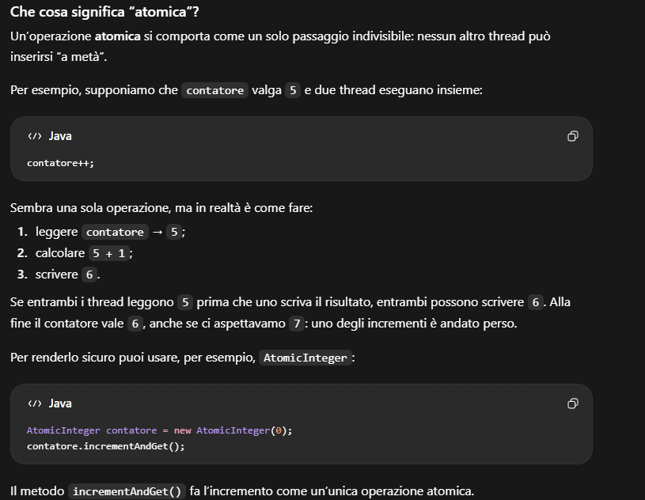

<h1 style="color:#C00000"><strong>GLOSSARIO PD: TERMINI DEI TUOI APPUNTI</strong></h1>

Definizioni raccolte da `0 GLOSSARIO.md`, `Z TERMINI PD` e dalla nota collegata `spazio di indirizzamento`. Le spiegazioni sui protocolli si riferiscono agli esempi didattici del vault.

<h2 style="color:#C00000"><strong>TRANSISTOR</strong></h2>

Componente elettronico impiegato anche come interruttore per rappresentare stati logici 0 e 1. La crescita del numero/densità dei transistor è il riferimento della legge empirica di Moore.

<h2 style="color:#C00000"><strong>CACHE</strong></h2>

Memoria piccola e veloce che conserva temporaneamente dati e istruzioni per ridurre accessi a memorie più lente. Un cache miss richiede un recupero da un altro livello.

<h2 style="color:#C00000"><strong>PROCESSO</strong></h2>

Programma in esecuzione con il proprio spazio di memoria e le proprie risorse. L’avvio di un lettore PDF esterno da parte del browser è un esempio intuitivo di collaborazione tra programmi/processi.

<h2 style="color:#C00000"><strong>THREAD</strong></h2>

Flusso di esecuzione nel processo. Condivide heap e risorse con gli altri thread del processo, ma ha il proprio stack e contesto.

<h2 style="color:#C00000"><strong>PIPE</strong></h2>

Canale tra processi, assimilabile a un tubo: una parte scrive e l’altra legge. È tipicamente un meccanismo locale; non va confuso con una chiamata a metodo remoto.

<h2 style="color:#C00000"><strong>SOCKET</strong></h2>

Endpoint di comunicazione tra programmi locali o su macchine differenti. Con TCP offre uno scambio bidirezionale di byte tra i due endpoint connessi.

<h2 style="color:#C00000"><strong>SCHEDULER</strong></h2>

Meccanismo che assegna tempo CPU ai thread eseguibili. Ready significa pronto ad attendere la CPU; Running significa attualmente eseguito; Waiting/Blocked sono attese differenti. Per i thread Java classici la pianificazione coinvolge JVM e sistema operativo.

<h2 style="color:#C00000"><strong>SNIPPET</strong></h2>

Piccolo frammento di codice mostrato come esempio. Può richiedere import, una classe e un metodo circostante: non tutti gli snippet sono programmi completi.

<h2 style="color:#C00000"><strong>FETCH</strong></h2>

Recuperare/leggere un dato o un’istruzione dalla memoria nel contesto hardware degli appunti. Non implica qui il comando Git con lo stesso nome.

<h2 style="color:#C00000"><strong>OPERAZIONE ATOMICA</strong></h2>

Appare come un’unica azione indivisibile agli altri thread. `contatore++` è composto da lettura, calcolo e scrittura; `AtomicInteger.incrementAndGet()` offre un incremento atomico. Più operazioni atomiche separate non diventano automaticamente un’unica transazione.



<h2 style="color:#C00000"><strong>SPAZIO DI INDIRIZZAMENTO</strong></h2>

Insieme degli indirizzi di memoria utilizzabili dal processo. JVM eseguite in processi differenti non usano direttamente i riferimenti locali dell’altra JVM: comunicano tramite richieste e dati, per esempio con RMI.

<h2 style="color:#C00000"><strong>STUB</strong></h2>

Rappresentante locale del servizio remoto sul client. Raccoglie metodo e parametri, li trasmette, attende il risultato e lo restituisce al chiamante. È un oggetto locale il cui metodo può avviare una comunicazione remota.

<h2 style="color:#C00000"><strong>SKELETON</strong></h2>

Componente lato server che interpreta richiesta e parametri, invoca il vero oggetto e trasmette risultato o errore. La nota lo descrive come un thread perché può essere eseguito da un gestore di richieste; in generale il ruolo non impone una classe Thread specifica.

Sequenza della nota originaria: server ascolta con `ServerSocket(9000)` → `accept()` restituisce il socket del client → prepara output/flush/input → legge il nome del metodo → legge eventuali parametri → invoca l’oggetto → invia il risultato. Se il client scrive prima nome e poi parametro, lo skeleton deve leggere nello stesso ordine.

```java
// Frammento del gestore server, assumendo gli stream già creati.
String metodo = (String) in.readObject();
if (metodo.equals("getNome")) {
    out.writeObject(mioServer.getNome());
    out.flush();
}
```

<h2 style="color:#C00000"><strong>HEADER DEGLI STREAM A OGGETTI</strong></h2>

Intestazione del formato di serializzazione scritta da ObjectOutputStream. ObjectInputStream la legge nel costruttore e può bloccarsi se il peer non l’ha ancora inviata. Se entrambi creano prima l’input, nessuno ha inviato l’header: creare output, fare flush, poi creare input evita questo blocco negli esempi.

```java
ObjectOutputStream out = new ObjectOutputStream(socket.getOutputStream());
out.flush();
ObjectInputStream in = new ObjectInputStream(socket.getInputStream());
```

Frammento da inserire in un metodo che dispone di `socket` e gestisce `IOException`. La direzione è relativa al programma: input riceve dal peer; output invia al peer.

<h2 style="color:#C00000"><strong>COMMIT E ROLLBACK</strong></h2>

Commit conferma l’unità transazionale; rollback annulla modifiche provvisorie secondo il protocollo. Una risposta persa dopo il commit non autorizza a duplicare ciecamente un addebito.

<h2 style="color:#C00000"><strong>COUNTDOWNLATCH</strong></h2>

Contatore di eventi a uso singolo: countDown() decrementa; await() attende zero. Non viene resettato automaticamente e non è il monitor degli oggetti usati in synchronized.

<h2 style="color:#C00000"><strong>LAMBDA E VARIABILI CATTURATE</strong></h2>

Una variabile locale catturata deve essere final o effectively final: non puoi riassegnarla nella lambda. Puoi modificare lo stato dell’oggetto riferito, come una cella di array, ma questo non garantisce automaticamente thread safety.

<h2 style="color:#C00000"><strong>INVOCAZIONE</strong></h2>

Richiesta a un componente di eseguire un’operazione. Nel caso di RMI il client invia la richiesta, la JVM server esegue il metodo sull’oggetto nella propria memoria e restituisce il risultato. Le JVM comunicano scambiandosi dati e richieste, senza usare direttamente i riferimenti locali dell’altra JVM.
