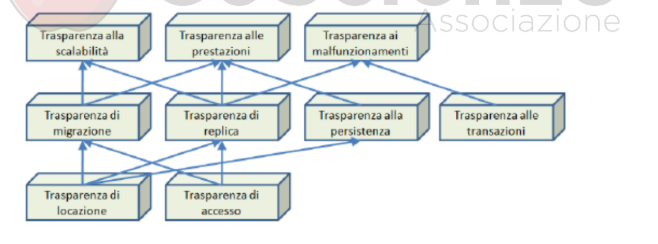

<h1 style="color:#C00000"><strong>SISTEMI DISTRIBUITI E MIDDLEWARE — APPUNTI TEORICI</strong></h1>

Questi appunti raccolgono il modello dei sistemi distribuiti, i requisiti di qualità, le trasparenze e l’evoluzione dal middleware RPC agli oggetti e componenti distribuiti, compresi gli esempi .NET ed Enterprise Java.

<h2 style="color:#C00000"><strong>1. MODELLO DI RIFERIMENTO E RM-ODP</strong></h2>

Un **sistema distribuito** è un insieme di computer o nodi autonomi, collegati da una rete, che collaborano per offrire servizi. I nodi mantengono una propria autonomia e comunicano tramite protocolli e, spesso, un livello middleware.

Un **modello di riferimento** è un modello concettuale, indipendente da una tecnologia specifica, che aiuta a descrivere e progettare un sistema.

**RM-ODP** (*Reference Model for Open Distributed Processing*) è un modello di riferimento per l’elaborazione distribuita aperta. Descrive il sistema da punti di vista diversi e aiuta a separare i problemi. Il testo che hai inviato lo collega a OSI tramite un layer **APPLICATION**, relativo alla comunicazione fra applicazioni. Questa è la formulazione del tuo testo; senza la slide originale non si può attribuirle con certezza un significato più preciso. Precisazione formale: RM-ODP non è soltanto un ulteriore livello dello stack OSI, ma un modello architetturale distinto e complementare. Conserva quindi il collegamento annotato nel corso, distinguendolo dalla definizione formale del modello.

<h2 style="color:#C00000"><strong>2. PERCHÉ SI USANO I SISTEMI DISTRIBUITI</strong></h2>

<h3 style="color:#C00000"><strong>MOTIVAZIONI ECONOMICHE</strong></h3>

- **Integrare sistemi aziendali:** organizzazioni diverse possono collegare infrastrutture e applicazioni già esistenti.
- **Downsizing nel contesto dei tuoi appunti:** separazione di aziende o unità dalla casa madre, mantenendo collaborazione e integrazione dei sistemi IT tramite una federazione. Il termine può anche indicare il ridimensionamento dell’infrastruttura, ma qui le tue annotazioni lo usano nel senso organizzativo.
- **Ridurre il time-to-market:** riusare componenti e integrare servizi esistenti può accelerare la realizzazione e il rilascio di un prodotto. Il riuso richiede però interfacce compatibili e integrazione ben progettata.

<h3 style="color:#C00000"><strong>MOTIVAZIONI TECNOLOGICHE</strong></h3>

- **Riuso ed evoluzione:** adottare nuove tecnologie senza ricominciare ogni volta da zero.
- **Integrazione di eterogeneità:** far collaborare hardware, sistemi operativi, linguaggi e servizi differenti.
- **Condivisione delle risorse e crescita:** aggiungere nodi o servizi per distribuire il lavoro.
- **Gestione di latenza e malfunzionamenti:** progettare la comunicazione considerando che la rete introduce ritardi e guasti parziali; il sistema distribuito non li elimina.

<h3 style="color:#C00000"><strong>LEGGI EMPIRICHE CITATE NEGLI APPUNTI</strong></h3>

Sono osservazioni storiche usate per descrivere la crescita delle risorse tecnologiche, non leggi fisiche che garantiscono una scadenza esatta:

- **Legge di Moore — formulazione dei tuoi appunti:** numero/densità dei transistor circa raddoppiati ogni 24 mesi. È un andamento storico: non implica automaticamente che ogni programma diventi due volte più veloce.
- **Legge di Gilder:** la capacità di trasmissione delle reti cresce molto rapidamente; negli appunti è riportato un raddoppio circa annuale.
- **Legge di “Shugard” — nome riportato nei tuoi appunti:** capacità di memorizzazione circa decuplicata ogni quattro anni. Mantengo nome e valore come nella fonte; l’attribuzione non è verificabile da questi soli appunti.

Queste regole aiutano a motivare l’evoluzione dei sistemi distribuiti: capacità di calcolo, rete e memoria crescono, ma cresce anche la necessità di collegare e coordinare risorse diverse.

<h2 style="color:#C00000"><strong>3. LEGGI SUL VALORE DELLE RETI</strong></h2>

Queste leggi descrivono in modo approssimativo come può crescere l’utilità di una rete al crescere degli utenti. Indichiamo con `n` e `m` gli utenti attivi di due gruppi che vengono collegati.

- **Sarnoff — crescita lineare:** il valore è proporzionale al numero di utenti. Unire i due gruppi porta da `n` e `m` utenti a circa `n + m` utenti/valore.
- **Metcalfe — crescita quadratica:** il valore è proporzionale al numero di possibili connessioni a coppie, approssimativamente `N²`. Dopo l’unione il valore è circa `(n + m)²`; l’aumento del modello `N²` è `2nm`. Se conti precisamente le coppie non orientate, il totale è `N(N−1)/2` e le nuove coppie tra i due gruppi sono `nm`, non `2nm`.
- **Reed — crescita esponenziale:** nelle reti che permettono di formare molti gruppi o sottoreti, il numero di gruppi possibili può crescere come `2^N`. Nei tuoi appunti, per l’unione di gruppi di dimensione `n` e `m`, la formula è `2^n · 2^m − (2^n + 2^m) = 2^(n+m) − 2^n − 2^m`.

Se vuoi contare esattamente i gruppi che includono almeno un utente di entrambe le reti, il numero è `(2^n − 1)(2^m − 1) = 2^(n+m) − 2^n − 2^m + 1`: il `+1` corregge il doppio conteggio del gruppo vuoto nella sottrazione. La formula originaria sopra è conservata come approssimazione riportata negli appunti.

Sono modelli intuitivi e semplificati: il valore reale dipende da utenti attivi, qualità dei collegamenti, utilità dei servizi e possibilità concreta di interagire. Non sono formule che predicono da sole il valore economico di qualsiasi rete.

<h2 style="color:#C00000"><strong>4. CARATTERISTICHE DEI SISTEMI DISTRIBUITI</strong></h2>

- **Remoti:** le componenti possono trovarsi su macchine fisicamente diverse e comunicare tramite rete.
- **Concorrenti:** più attività procedono nello stesso periodo su nodi diversi o nella stessa macchina. Senza coordinamento non si può presumere un ordine unico delle operazioni.
- **Senza stato globale immediatamente disponibile:** non esiste necessariamente un unico osservatore che conosca in ogni istante lo stato aggiornato di tutti i nodi. La rete introduce ritardi e informazioni che arrivano in momenti diversi.
- **Soggetti a malfunzionamenti parziali:** un nodo o collegamento può guastarsi mentre altri componenti continuano a funzionare.
- **Eterogenei e autonomi:** possono includere hardware, sistemi operativi, linguaggi e servizi differenti, gestiti da amministratori diversi.
- **In evoluzione:** componenti e tecnologie possono essere sostituite o aggiornate nel tempo.
- **Mobili:** nodi, processi, servizi o dati possono essere spostati tra macchine o luoghi diversi.

<h2 style="color:#C00000"><strong>5. REQUISITI NON FUNZIONALI</strong></h2>

I **requisiti non funzionali** descrivono qualità e vincoli del sistema, cioè come le funzioni devono essere fornite, non le singole operazioni richieste.

| Qualità | Significato |
|---|---|
| Apertura | Interfacce e protocolli documentati e standard facilitano interoperabilità ed evoluzione. La portabilità permette di eseguire o adattare moduli in ambienti diversi. |
| Integrazione | Sistemi e risorse differenti possono collaborare senza che ogni applicazione debba conoscere dettagli specifici di ciascuna piattaforma. |
| Flessibilità | Il sistema può riconfigurarsi e cambiare organizzazione quando variano requisiti o carico. |
| Modularità | Il sistema è suddiviso in componenti con compiti definiti; si può aggiornare un modulo limitando gli effetti sul resto. |
| Federazione | Sistemi autonomi collaborano per offrire un servizio mantenendo ciascuno la propria gestione. |
| Gestibilità | Sono disponibili strumenti e procedure per configurare, monitorare, aggiornare e amministrare il sistema. |
| Qualità del servizio | Prestazioni, disponibilità e affidabilità rispettano livelli adeguati. La tolleranza ai guasti mira a mantenere almeno le funzioni essenziali quando una parte si guasta. |
| Scalabilità | Il sistema mantiene un servizio adeguato quando crescono utenti, richieste o dati, per esempio aggiungendo risorse o distribuendo il carico. |
| Sicurezza | Accessi e operazioni sono consentiti solo a soggetti autorizzati e i dati sono protetti. |
| Trasparenza | L’utente o il programmatore non deve gestire direttamente ogni dettaglio della distribuzione, come la posizione fisica dei server. |

Queste sono qualità da progettare e verificare: la distribuzione o l’uso di middleware non le garantiscono automaticamente.

<h2 style="color:#C00000"><strong>6. TRASPARENZA DELLA DISTRIBUZIONE</strong></h2>

La **trasparenza** nasconde alcuni dettagli della distribuzione agli utenti o al programmatore, così da fornire un’interfaccia più uniforme. Non significa che ogni dettaglio sia sempre invisibile: ritardi e guasti di rete possono rendere evidente la natura distribuita.

| Tipo di trasparenza | Che cosa nasconde |
|---|---|
| Accesso | Differenze di rappresentazione e uso di una risorsa locale o remota. |
| Locazione | La posizione fisica della risorsa. |
| Migrazione | Lo spostamento di una risorsa o di un processo tra computer mentre continua a essere usato. |
| Replica | La presenza di più copie della stessa risorsa e la scelta della copia utilizzata. |
| Transazioni (etichetta presente nei tuoi appunti) | Il sistema applica il coordinamento e le proprietà della transazione, così che più modifiche costituiscano un’unità coerente. |
| Concorrenza (distinzione aggiunta) | Accessi contemporanei alla stessa risorsa vengono coordinati senza affidare ogni dettaglio al client. |
| Malfunzionamenti | Parte del guasto e del recupero, per esempio un tentativo alternativo tramite una replica. La trasparenza completa dei guasti non è sempre possibile. |
| Persistenza | Dove e come una risorsa viene conservata nel tempo. |
| Scalabilità | I dettagli tecnici usati per far fronte alla crescita del carico. |
| Prestazioni | Le decisioni con cui si cerca di migliorare velocità ed efficienza. |

Nel testo originale la riga “Transazioni” descrive soprattutto accessi concorrenti: i due temi sono collegati, ma non equivalenti. La concorrenza riguarda l’interferenza tra attività; una transazione aggiunge un’unità di lavoro e regole come commit/rollback.

**Prestazioni** e **scalabilità** sono collegate ma diverse: le prestazioni riguardano velocità o efficienza nelle condizioni correnti; la scalabilità riguarda il mantenimento di un servizio adeguato quando il carico cresce.

<h2 style="color:#C00000"><strong>7. MIDDLEWARE</strong></h2>

Il **middleware** è uno strato software tra le applicazioni e i servizi di sistema che fornisce funzioni comuni, soprattutto quando le componenti comunicano tra computer e piattaforme differenti.

Si può leggere attraverso tre ruoli:

| Ruolo | Funzioni |
|---|---|
| Infrastruttura | Nasconde differenze tra sistemi operativi e fornisce basi comuni per comunicazione e concorrenza. |
| Supporto alla distribuzione | Automatizza operazioni come marshalling, riuso dei canali, invocazioni remote e rilevamento/gestione di alcuni guasti. |
| Servizi comuni | Offre funzioni riutilizzabili come sicurezza, persistenza e gestione delle transazioni. |

**Marshalling** è la conversione di parametri e dati in una forma trasmissibile; sul destinatario i dati vengono ricostruiti (unmarshalling). Un canale, come un socket, può trasportare più richieste secondo un protocollo concordato.

Il middleware può supportare diverse modalità di invocazione, per esempio unicast o multicast. Alcuni sistemi storici prevedevano l’attivazione di oggetti su richiesta; la disponibilità concreta dipende dalla tecnologia.

Separare questi compiti consente al programmatore di concentrarsi sulla logica di business senza reimplementare per ogni applicazione tutto il trasporto e i servizi comuni.

<h3 style="color:#C00000"><strong>MIDDLEWARE ESPLICITO E IMPLICITO — SLIDE 32</strong></h3>

- **Esplicito:** il codice applicativo invoca direttamente le API di sicurezza, transazione, database o comunicazione. Offre controllo diretto, ma può mescolare infrastruttura e logica di business e legare il codice a API specifiche.
- **Implicito:** l’applicazione dichiara i servizi richiesti tramite configurazione o metadati; container o runtime li applicano automaticamente, per esempio attraverso interceptor.

Il middleware implicito può separare meglio i compiti, ma richiede configurazione coerente, strumenti adeguati e verifica che le regole dichiarate siano effettivamente applicate.

<h3 style="color:#C00000"><strong>COMUNICAZIONE E SERVIZI ESPLICITI — SLIDE 33–35</strong></h3>

Nel percorso di una chiamata remota, il client invoca l’interfaccia, lo stub prepara la richiesta, la rete la trasporta, lo skeleton la riceve e la inoltra all’oggetto distribuito. L’oggetto esegue il metodo e il risultato torna sul percorso inverso. Stub e skeleton nascondono dettagli di rete.

Il codice può poi invocare direttamente servizi comuni, per esempio:

- **Transaction Service** tramite una Transaction API;
- **Security Service** tramite una Security API;
- **Database Driver** tramite una Database API.

Nell’esempio di trasferimento tra conti, il metodo controlla l’autorizzazione, avvia la transazione, carica i dati, modifica i saldi, salva e conclude la transazione. La logica di business si mescola così con sicurezza, transazioni e database. Il codice diventa più complesso e dipende dalle API specifiche, perciò un cambiamento può richiedere modifiche all’applicazione e ai client.

<h3 style="color:#C00000"><strong>MIDDLEWARE IMPLICITO: DEPLOYMENT E INTERCEPTOR — SLIDE 36–37</strong></h3>

Nel modello desiderato, il metodo contiene la logica di business (per esempio sottrarre da un conto e aggiungere all’altro), mentre sicurezza, persistenza e transazione vengono dichiarate separatamente. Le slide citano un file XML chiamato **deployment descriptor**. Un tool o container legge la configurazione e prepara gli interventi necessari, come un **request interceptor**.

L’interceptor opera prima che la richiesta raggiunga l’oggetto: riceve la chiamata, applica i servizi dichiarati (per esempio controlli di sicurezza o transazione, con accesso al driver database quando serve) e inoltra poi la richiesta al componente. L’oggetto può concentrarsi sulla logica applicativa; configurazione e codice devono comunque restare coerenti.

<h2 style="color:#C00000"><strong>8. DA RPC AGLI OGGETTI DISTRIBUITI</strong></h2>

<h3 style="color:#C00000"><strong>RPC — REMOTE PROCEDURE CALL</strong></h3>

**RPC** permette a un programma su un computer di invocare una procedura che viene eseguita su un altro computer. La rete trasporta dati, non parametri Java/C# “così come sono”: parametri e risultati vengono codificati (marshalling) in una forma trasmissibile, per esempio byte.

Nel modello sincrono descritto, il client attende la risposta del server. Questo rende semplice seguire la sequenza della chiamata, ma introduce attesa e possibilità di errore dovute alla rete.

Gli **stub** nascondono parte del lavoro:

- lo stub client prepara e invia la richiesta;
- lo stub server riceve la richiesta e la consegna alla procedura corretta.

Questi componenti effettuano anche il marshalling e la ricostruzione dei parametri. La chiamata può apparire simile a una locale, ma non ha le stesse garanzie: la rete può ritardare o fallire.

<h3 style="color:#C00000"><strong>MIDDLEWARE A OGGETTI DISTRIBUITI</strong></h3>

Il passo successivo integra le chiamate remote con la programmazione a oggetti: il client invoca un’operazione esposta da un oggetto o componente remoto.

Un **componente** è un modulo riutilizzabile che espone funzionalità attraverso un’interfaccia. L’interfaccia comunica cosa offre, mentre l’implementazione descrive come lo fa. Il middleware inoltra le chiamate e riporta i risultati; per interoperare, le parti devono comunque concordare formato e significato dei dati.

Gli obiettivi sono favorire riuso, interoperabilità, estendibilità e gestione. Questi vantaggi dipendono da interfacce compatibili e da una progettazione adeguata: il middleware non converte automaticamente qualsiasi formato o piattaforma incompatibile.

<h2 style="color:#C00000"><strong>9. ESEMPI DI MIDDLEWARE E COMPONENTI</strong></h2>

<h3 style="color:#C00000"><strong>CORBA</strong></h3>

CORBA mira a far collaborare oggetti scritti in linguaggi diversi. È un esempio di middleware a oggetti distribuiti; la complessità e le difficoltà di interoperabilità sono fra i limiti discussi nelle slide.

<h3 style="color:#C00000"><strong>JAVA RMI</strong></h3>

**Java Remote Method Invocation** permette a un programma Java di invocare metodi di oggetti remoti. Il dettaglio di interfacce, stub, registry e serializzazione è raccolto in [Java RMI](JAVA%20RMI.md).

<h3 style="color:#C00000"><strong>.NET E .NET REMOTING — SLIDE 29</strong></h3>

Il **.NET Framework** è la piattaforma di sviluppo ed esecuzione illustrata dalla slide; il **CLR** esegue programmi .NET e fornisce servizi comuni a linguaggi come C# e Visual Basic. **.NET Remoting** è una tecnologia storica per comunicare tra oggetti in processi o macchine diversi. La slide menziona anche la successiva **Windows Communication Foundation (WCF)**.

La slide 29 collega storicamente questi meccanismi anche a **COM e DCOM**: vanno riconosciuti come predecessori nel percorso della lezione.

Sono tecnologie legacy rispetto agli strumenti moderni delle rispettive piattaforme: .NET Remoting non è il modello da scegliere per nuove applicazioni .NET moderne; WCF è anch’esso una tecnologia di generazioni precedenti, con supporto dipendente dalla versione. Gli esempi servono a capire l’evoluzione del middleware.

<h3 style="color:#C00000"><strong>JAVA ENTERPRISE ED EJB — SLIDE 31</strong></h3>

Le applicazioni enterprise possono separare:

- **livello di presentazione**, che prepara ciò che vede l’utente;
- **livello di business**, che applica le regole dell’applicazione e comunica con i dati o con sistemi legacy.

Gli **Enterprise JavaBeans (EJB)**, oggi Jakarta Enterprise Beans, sono componenti enterprise ospitati da un **container**, tipicamente all’interno di un application server. La slide 31 sottolinea sei punti:

1. **Riuso e minore complessità:** combinare componenti già realizzati.
2. **Presentazione separata dal business:** sviluppare e scalare le due responsabilità in modo diverso.
3. **Trasparenze di accesso, locazione e migrazione:** ridurre i dettagli distributivi gestiti dall’applicazione, nei limiti del sistema impiegato.
4. **Modello a componenti:** moduli riutilizzabili, combinabili e distribuibili anche in forma binaria.
5. **Container:** ambiente che gestisce componenti e servizi come sicurezza e transazioni; la persistenza dipende dal modello/versione e dall’integrazione adottata.
6. **Middleware implicito:** dichiarare servizi e politiche lasciando che il container li applichi.

Nel testo del corso Java RMI è indicato come supporto alle invocazioni dei componenti Java distribuiti, inclusi gli EJB esposti da remoto. Il contratto può però prevedere anche una vista locale: non ogni chiamata a un componente EJB attraversa necessariamente la rete.

<h2 style="color:#C00000"><strong>10. RIEPILOGO E FILO CONDUTTORE — SLIDE 30 E 38–40</strong></h2>

Il piano esplicito è: **introduzione e motivazioni → evoluzione da RPC agli oggetti → esempi CORBA/.NET Remoting/Java RMI → conclusioni**. La slide 30 evidenzia gli esempi, la 38 le conclusioni; la 39 riassume il ruolo degli oggetti distribuiti (riuso, interoperabilità ed evoluzione architetturale); la 40 anticipa il passaggio dai socket, a basso livello, agli oggetti remoti.

L’evoluzione va dalla comunicazione a basso livello con i socket, a RPC, fino a oggetti e componenti distribuiti. Ogni passaggio introduce un’astrazione che nasconde parte dei dettagli tecnici. Il middleware centralizza comunicazione e servizi comuni; l’applicazione definisce le responsabilità dei componenti e le regole di business. Scalabilità e tolleranza ai guasti sono obiettivi progettuali, non proprietà automatiche degli oggetti remoti.

<h2 style="color:#C00000"><strong>CONCETTI CHIAVE DA SAPER COLLEGARE ALL’ESAME</strong></h2>

- Un sistema distribuito è fatto di nodi autonomi collegati in rete; i guasti possono essere parziali e non esiste necessariamente una vista globale istantanea.
- Distingui caratteristiche del sistema, requisiti non funzionali e trasparenze: le prime descrivono il contesto, i requisiti descrivono le qualità desiderate, le trasparenze nascondono specifici dettagli distributivi.
- Le motivazioni economiche includono integrazione, downsizing e time-to-market; quelle tecnologiche includono riuso, eterogeneità e crescita delle risorse.
- Sarnoff è lineare, Metcalfe quadratica per collegamenti tra coppie, Reed esponenziale per gruppi possibili. Sono modelli del valore di rete, non garanzie universali.
- Il middleware è l’intermediario che offre infrastruttura, supporto alla distribuzione e servizi comuni.
- RPC invoca procedure remote; oggetti distribuiti espongono operazioni tramite interfacce; i componenti sono moduli riusabili che collaborano attraverso contratti.
- Middleware esplicito significa chiamare API dal codice; middleware implicito significa dichiarare servizi e lasciare che container/interceptor li applichino.
- Le tecnologie e le trasparenze riducono dettagli da gestire, ma non eliminano latenza, guasti, incompatibilità o necessità di configurazione.

<h2 style="color:#C00000"><strong>INTEGRAZIONI DALLE LEZIONI E DALLE ANNOTAZIONI OBSIDIAN</strong></h2>

**Sistemi IT:** computer, database e applicazioni dell’organizzazione. Integrare aziende dopo una fusione, oppure mantenerle in collaborazione dopo una separazione, richiede contratti e interfacce comuni. I componenti già disponibili sul mercato (*off the shelf*) possono ridurre il time-to-market. La conservazione dei sistemi **legacy** richiede adattatori/interfacce compatibili: la distribuzione non trasforma automaticamente software incompatibile.

**Assenza di clock globale:** ogni nodo possiede un proprio orologio e i clock possono divergere. I timestamp di due nodi non bastano da soli a determinare l’ordine causale di tutti gli eventi; ritardi e guasti rendono il coordinamento più difficile che in memoria condivisa. Sincronizzare gli orologi può limitare lo scarto, non creare un orologio perfetto istantaneamente condiviso.

**Mobilità:** il nodo può essere una macchina virtuale o un servizio in container. Migrazione e ricollocazione possono aiutare a spostare il carico, ma l’assenza di interruzioni dipende dal meccanismo usato: non è garantita da ogni spostamento di un container.

<h3 style="color:#C00000"><strong>DIPENDENZE FRA LE TRASPARENZE</strong></h3>

Il diagramma originario si legge per livelli:

- **Base:** accesso e locazione.
- **Intermedio:** migrazione, replica, persistenza e transazioni.
- **Superiore:** scalabilità, prestazioni e malfunzionamenti.

Migrazione e replica richiedono nomi/interfacce che non costringano il client a inseguire la posizione fisica. La persistenza deve permettere di ritrovare un oggetto anche dopo disattivazione e riattivazione. Scalabilità usa migrazione e replica per spostare o distribuire il carico; prestazioni può combinare migrazione, replica e persistenza. Recuperare dai guasti richiede anche coerenza delle operazioni: una replica disponibile non risolve da sola una transazione lasciata a metà. Le frecce rappresentano le relazioni illustrate dal corso, non una promessa di trasparenza assoluta.

<h3 style="color:#C00000"><strong>RETRY, REPLICHE, COMMIT E OPERAZIONI DUPLICATE</strong></h3>

Esempio delle annotazioni: se il server non risponde, si può ritentare su una replica. **Leggere un saldo** non modifica il conto; **addebitare 10 €** due volte può invece produrre un addebito di 20 €. Occorre riconoscere la stessa richiesta, per esempio con un identificativo univoco e una gestione idempotente/deduplicata.

Per trasferire 10 € da A a B occorre togliere 10 € da A e aggiungerli a B come una sola unità logica. **Commit** conferma la transazione; **rollback** annulla gli effetti provvisori quando il protocollo lo consente. Se il guasto avviene prima del commit, il recupero deve evitare uno stato parziale. Se il server ha fatto commit ma la risposta è andata persa, il client non può dedurre dall’assenza di risposta che l’operazione non sia avvenuta: prima di ritentare deve evitare una duplicazione.

<h3 style="color:#C00000"><strong>CORBA: IDL, ORB E IIOP</strong></h3>

Le domande del vault richiedono anche l’architettura CORBA, oltre al semplice nome della tecnologia:

- **CORBA** definisce uno standard per oggetti distribuiti su linguaggi e piattaforme differenti.
- **IDL** descrive le interfacce indipendentemente dal linguaggio di implementazione; gli strumenti possono generare stub client e skeleton server.
- **ORB (Object Request Broker)** media l’invocazione: usa il riferimento all’oggetto, trasporta richiesta e parametri, raggiunge il componente server tramite gli adattatori appropriati e riporta risultato o errore.
- **IIOP** è un protocollo previsto per l’interoperabilità fra ORB.

Percorso da saper spiegare: **client → stub generato dall’interfaccia IDL → ORB/protocollo → adattatore e skeleton server → oggetto → risposta in senso inverso**. Identità, riferimenti, stato e ciclo di vita degli oggetti sono problemi aggiuntivi rispetto a una semplice procedura RPC.

**Costo del middleware:** servizi comuni e riuso aiutano sistemi complessi; in applicazioni piccole, configurazione, dipendenze e overhead possono superare i vantaggi. L’efficienza di progettazione e la velocità di esecuzione non sono la stessa proprietà.

<h2 style="color:#C00000"><strong>DOMANDE ORIGINALI DEL VAULT: PROLOGO</strong></h2>

Domande e risposte provenienti dal tuo file `2 DOMANDE/1 PROLOGO.md`. I riferimenti numerici `[cite: ...]` nel file non avevano una bibliografia allegata: non vengono presentati come citazioni verificabili.

<h3 style="color:#C00000"><strong>P1. COSA È UN SISTEMA DISTRIBUITO?</strong></h3>

Un sistema distribuito consiste di un insieme di macchine, ognuna gestita in maniera autonoma, che sono connesse attraverso una rete. Ogni nodo di questo sistema esegue un insieme di componenti che comunicano e coordinano il proprio lavoro attraverso uno specifico strato software chiamato "middleware". Lo scopo finale è fare in modo che l'utente finale percepisca l'intero sistema distribuito come un'unica entità integrata.

<h3 style="color:#C00000"><strong>P2. QUALI SONO LE MOTIVAZIONI TECNOLOGICHE AI SISTEMI DISTRIBUITI?</strong></h3>

Lo sviluppo dell'informatica è sempre stato guidato dal rapidissimo sviluppo delle tecnologie hardware. Le capacità di calcolo, comunicazione e memorizzazione offerte oggi verranno rapidamente superate nel giro di pochissimi anni. I sistemi distribuiti permettono di affrontare le problematiche derivanti da questa complessità tecnologica: gestire i malfunzionamenti parziali (riconoscimento e recovery), risolvere i problemi di latenza, gestire l'accesso concorrente alle risorse e ottimizzare il carico di lavoro tra i diversi nodi in un panorama in continua evoluzione.

<h3 style="color:#C00000"><strong>P3. QUALI SONO LE MOTIVAZIONI ECONOMICHE AI SISTEMI DISTRIBUITI?</strong></h3>

I sistemi distribuiti rispondono in maniera precisa alle esigenze dell'economia di mercato, permettendo di:

* Affrontare in tempi brevi l'integrazione dei sistemi informatici di aziende diverse in seguito a frequenti fusioni o acquisizioni.
* Gestire il meccanismo di "downsizing", permettendo alle aziende separate dalla "casa madre" di mantenere un livello di integrazione (federazione di sistemi).
* Ridurre il più possibile il *time to market* (il tempo dalla progettazione al prodotto finale) per far fronte al continuo ricambio tecnologico e alle mutevoli richieste dei consumatori.
* Permettere l'assemblaggio rapido di funzionalità complesse utilizzando componenti preesistenti (*prodotti off the shelf*).

<h3 style="color:#C00000"><strong>P4. COSA È LA "LEGGE" DI MOORE?</strong></h3>

La formulazione del corso indica un raddoppio del numero/densità dei transistor ogni 24 mesi. È una regolarità empirica, non una garanzia di raddoppio della velocità di ogni programma. **Correzione del valore nel testo originale:** con raddoppi ogni due anni, il fattore 10 si raggiunge in `2 × log2(10) ≈ 6,64 anni`, non in poco più di cinque anni.

<h3 style="color:#C00000"><strong>P5. IN CHE MANIERA UN SISTEMA DISTRIBUITO PERMETTE DI RISPONDERE EFFICACEMENTE AL PROGRESSO TECNOLOGICO PRESERVANDO LE RISORSE LEGACY?</strong></h3>

Un sistema distribuito asseconda l'evoluzione dell'ambiente e della tecnologia grazie al requisito della flessibilità e dell'integrazione. Il sistema può cambiare in maniera sostanziale durante la sua vita, assicurando che la migrazione verso nuovi ambienti e tecnologie diverse possa avvenire con successo e senza costi eccessivi. L'uso di modelli aperti e ampiamente condivisi permette l'interoperabilità, consentendo di integrare al proprio interno anche le vecchie risorse o i sistemi preesistenti senza doverli necessariamente riscrivere o dismettere.

<h3 style="color:#C00000"><strong>P6. COSA SONO LE "LEGGI" DI SARNOFF / METCALFE / REED?</strong></h3>

Sono leggi empiriche che fanno riferimento alla crescita del valore aggiunto generato da una rete all'aumentare del numero dei suoi utenti (N):

* **Legge di Sarnoff:** Il valore di una rete di broadcasting è direttamente proporzionale al numero di utenti collegati, registrando una crescita di tipo lineare. Unendo una rete di N utenti e una di M utenti, il valore generato sarà N + M.
* **Legge di Metcalfe:** Il valore di un sistema di comunicazione cresce con il quadrato del numero di persone collegate ($N^2$). Unendo N e M utenti attivi, la formula è $N^2 + M^2 + 2NM$, evidenziando un surplus di valore.
* **Legge di Reed:** L'utilità delle grandi reti di relazioni sociali cresce in modo esponenziale rispetto alla dimensione della rete. Unendo gruppi di N e M utenti, la crescita esponenziale sprigiona un valore misurabile come $2^N * 2^M - (2^N + 2^M)$.

<h3 style="color:#C00000"><strong>P7. PERCHÈ NELLE DOMANDE PRECEDENTI, LA PAROLA "LEGGE" VIENE MESSA TRA VIRGOLETTE?</strong></h3>

Si parla di “leggi” empiriche perché derivano da osservazioni e modelli approssimativi. Non sono leggi fisiche assolute: possono descrivere un periodo storico e non garantiscono la stessa crescita in futuro.

<h3 style="color:#C00000"><strong>P8. CHE COSA È IL MIDDLEWARE E QUALE È IL SUO RUOLO?</strong></h3>

Il middleware è uno strato software che risiede tra le applicazioni (gli oggetti distribuiti) e lo strato del sistema operativo. Il suo ruolo è permettere alle varie componenti di comunicare e coordinarsi per far percepire il sistema come un'unica entità. Per facilitare il lavoro ai programmatori, il middleware rende semplici i compiti complessi fornendo adeguate astrazioni, sollevandoli dal doversi occupare dei dettagli di comunicazione di basso livello (come trasformare le strutture dati in stream di byte o datagrammi per la rete).

<h3 style="color:#C00000"><strong>P9. PERCHÈ LE RETI SONO NATURALMENTE (DAL PUNTO DI VISTA ECONOMICO) PORTATE AD ACCORPARSI, INTEGRANDO I SERVIZI IN MODO DA FORNIRLI AGLI UTENTI DI TUTTE LE RETI CHE SI STANNO FONDENDO? E CHE COSA HA A CHE FARE QUESTO CON LE LEGGI DI METCALFE / REED? E PERCHÉ QUESTO CAPITA IN MANIERA MOLTO MINORE CON LA LEGGE DI SARNOFF (MA CAPITA COMUNQUE)?</strong></h3>

* **L'accorpamento e le Leggi di Metcalfe/Reed:** Le reti tendono ad accorparsi perché, unendosi, generano un enorme surplus economico rispetto a quando erano separate. Questo si spiega perfettamente con le formule matematiche del valore di rete: nella Legge di Metcalfe, unendo due reti si genera il valore aggiuntivo di interazione $2NM$ (che prima non esisteva). Nella Legge di Reed, dedicata ai gruppi sociali, l'accorpamento è ancora più esplosivo perché moltiplica in modo esponenziale le possibilità di aggregazione ($2^N * 2^M$), fornendo guadagni enormi a fronte di spese infrastrutturali condivise.
* **Il caso della Legge di Sarnoff:** La Legge di Sarnoff riguarda il broadcasting (dove l'utente è un recettore passivo), per cui unendo le reti la crescita rimane strettamente lineare (N + M). Non c'è un boom di valore esponenziale scatenato dall'interazione diretta tra i nuovi utenti, per questo l'incentivo è "molto minore". Tuttavia l'accorpamento capita ugualmente per ragioni economiche basilari: abbattimento dei costi, economie di scala e consolidamento del mercato.

<h2 style="color:#C00000"><strong>DOMANDE ORIGINALI DEL VAULT: SISTEMI APERTI E MIDDLEWARE</strong></h2>

Tutte le 46 risposte del tuo file `2 DOMANDE/2 OPEN.md`; l’elenco iniziale di sole domande era una ripetizione degli stessi quesiti.

<h3 style="color:#C00000"><strong>O1. CHE COS’È UN MODELLO DI RIFERIMENTO (<em>REFERENCE MODEL</em>) E A COSA SERVE?</strong></h3>

È uno schema concettuale che descrive le parti principali di un sistema e le relazioni tra esse. Serve a organizzare i concetti, confrontare architetture diverse e fornire un linguaggio comune a progettisti, sviluppatori e studenti. Non è necessariamente un progetto da implementare così com’è.

<h3 style="color:#C00000"><strong>O2. CHE COSA SONO I REQUISITI NON FUNZIONALI DI UN SISTEMA?</strong></h3>

Descrivono _come_ il sistema deve funzionare, più che quali funzioni deve offrire. Esempi: sicurezza, prestazioni, affidabilità, usabilità, scalabilità, manutenibilità e disponibilità.

<h3 style="color:#C00000"><strong>O3. QUAL È LA DIFFERENZA SOSTANZIALE TRA UN SISTEMA DISTRIBUITO E UNO PARALLELO O CONCORRENTE?</strong></h3>

Un sistema distribuito è composto da computer autonomi collegati da una rete: ogni nodo ha risorse e memoria proprie e comunica con gli altri tramite messaggi. Un sistema parallelo esegue attività contemporaneamente usando più unità di calcolo, spesso coordinate più strettamente. _Concorrente_ descrive invece più attività che avanzano nello stesso intervallo di tempo: sia un sistema distribuito sia uno parallelo possono essere concorrenti.

<h3 style="color:#C00000"><strong>O4. PERCHÉ UN SISTEMA DISTRIBUITO È CONCORRENTE E PERCHÉ GESTIRE LA CONCORRENZA È PIÙ COMPLESSO CHE IN UN SISTEMA CENTRALIZZATO?</strong></h3>

È concorrente perché più nodi possono svolgere attività nello stesso momento e accedere contemporaneamente a risorse condivise. È più complesso perché non esiste un unico controllore che conosce sempre lo stato di tutti: i messaggi possono arrivare in ritardo o in ordine diverso, e un nodo può guastarsi mentre gli altri continuano a funzionare. Bisogna quindi coordinare le operazioni e prevenire inconsistenze.

<h3 style="color:#C00000"><strong>O5. CHE SIGNIFICA CHE IN UN SISTEMA DISTRIBUITO MANCA UN CLOCK GLOBALE E CHE COSA COMPORTA?</strong></h3>

Ogni nodo ha un proprio orologio, che può essere leggermente diverso da quello degli altri; non esiste un orologio perfetto e condiviso da tutti. Di conseguenza, l’ora registrata su due nodi non basta sempre a stabilire con certezza quale evento sia avvenuto prima. Servono meccanismi di sincronizzazione o regole per ricostruire l’ordine degli eventi.

<h3 style="color:#C00000"><strong>O6. CHE COSA SIGNIFICA CHE UN SISTEMA DISTRIBUITO PUÒ TOLLERARE MALFUNZIONAMENTI PARZIALI?</strong></h3>

Significa che può guastarsi un nodo o un servizio mentre il resto del sistema continua a funzionare. Il sistema cerca di limitare il guasto e, se possibile, recuperare usando componenti alternativi o copie dei dati. Non significa che ogni guasto possa essere nascosto o che il servizio rimanga sempre completamente disponibile.

<h3 style="color:#C00000"><strong>O7. PERCHÉ UN SISTEMA DISTRIBUITO È ETEROGENEO?</strong></h3>

Perché può riunire computer con hardware, sistemi operativi, reti, linguaggi di programmazione e applicazioni differenti. Il middleware e gli standard di comunicazione aiutano questi elementi diversi a collaborare.

<h3 style="color:#C00000"><strong>O8. CHE SIGNIFICA CHE UN SISTEMA DISTRIBUITO ASSECONDA L’EVOLUZIONE AZIENDALE?</strong></h3>

Significa che può essere modificato per seguire i cambiamenti dell’organizzazione: aggiungere servizi, utenti, sedi o nuove applicazioni. La modularità e la possibilità di integrare sistemi preesistenti riducono la necessità di riscrivere tutto da zero.

<h3 style="color:#C00000"><strong>O9. PERCHÉ UN SISTEMA DISTRIBUITO OFFRE AUTONOMIA DI GESTIONE AI SINGOLI NODI?</strong></h3>

Ogni nodo può appartenere a un gruppo o a un’organizzazione che lo amministra autonomamente, decidendo configurazioni e manutenzione. I nodi collaborano tramite protocolli e interfacce comuni, pur senza essere necessariamente controllati da un’unica autorità.

<h3 style="color:#C00000"><strong>O10. CHE COSA SIGNIFICA CHE UN SISTEMA DISTRIBUITO DEVE ESSERE APERTO?</strong></h3>

Deve usare interfacce e protocolli documentati e, quando possibile, standard riconosciuti. Questo facilita l’interoperabilità tra componenti diversi e permette di sostituirli o estenderli più facilmente.

<h3 style="color:#C00000"><strong>O11. CHE COSA SIGNIFICA CHE UN SISTEMA DISTRIBUITO DEVE ESSERE INTEGRATO?</strong></h3>

Deve poter combinare sistemi e risorse eterogenei senza richiedere ogni volta collegamenti progettati appositamente. L’integrazione consente a hardware, software e applicazioni diversi di collaborare.

<h3 style="color:#C00000"><strong>O12. CHE COSA SIGNIFICA CHE UN SISTEMA DISTRIBUITO DEVE ESSERE FLESSIBILE?</strong></h3>

Deve poter essere modificato, ampliato o riconfigurato con relativa facilità, anche integrando sistemi già esistenti, detti _legacy_. Alcune modifiche dovrebbero poter essere effettuate senza fermare l’intero servizio.

<h3 style="color:#C00000"><strong>O13. CHE COSA SIGNIFICA CHE UN SISTEMA DISTRIBUITO DEVE ESSERE MODULARE?</strong></h3>

Deve essere composto da parti distinguibili, con funzioni e interfacce definite. Ogni componente può essere modificato o sostituito limitando gli effetti sugli altri.

<h3 style="color:#C00000"><strong>O14. CHE COSA SIGNIFICA SUPPORTARE LA FEDERAZIONE DI SISTEMI?</strong></h3>

Significa permettere a sistemi autonomi di collaborare e offrire servizi congiunti, mantenendo ciascuno parte del proprio controllo. Per esempio, organizzazioni diverse possono federare i propri servizi di autenticazione.

<h3 style="color:#C00000"><strong>O15. CHE COSA SIGNIFICA CHE UN SISTEMA DEVE ESSERE FACILMENTE GESTIBILE?</strong></h3>

Significa poterlo monitorare, configurare, aggiornare e manutenere con strumenti e procedure adeguati. La gestione deve includere anche accessi, qualità del servizio e individuazione dei guasti.

<h3 style="color:#C00000"><strong>O16. CHE COSA SIGNIFICA CHE UN SISTEMA DEVE ESSERE SCALABILE?</strong></h3>

Significa che può gestire un aumento di utenti, richieste o dati aggiungendo risorse o distribuendo meglio il carico, senza richiedere una riprogettazione completa.

<h3 style="color:#C00000"><strong>O17. CHE COSA SIGNIFICA CHE UN SISTEMA DEVE ESSERE TRASPARENTE?</strong></h3>

Significa nascondere all’utente o al programmatore alcuni dettagli interni della distribuzione, come la posizione dei dati, la presenza di copie o il lavoro necessario per recuperare un guasto. La complessità resta, ma viene gestita dal sistema.

<h3 style="color:#C00000"><strong>O18. CHE COS’È LA TRASPARENZA DI ACCESSO?</strong></h3>

Nasconde le differenze tra il modo di rappresentare i dati e il modo di invocare una risorsa locale o remota. Si può usare un’interfaccia uniforme senza sapere se la risorsa è sul proprio computer o su un server. Qui “accesso” indica il modo di usare la risorsa, non i permessi di sicurezza.

<h3 style="color:#C00000"><strong>O19. CHE COS’È LA TRASPARENZA DI LOCAZIONE?</strong></h3>

Nasconde la posizione fisica di una risorsa. L’utente la identifica con un nome logico e non deve sapere su quale macchina si trovi.

<h3 style="color:#C00000"><strong>O20. CHE COSA SONO LA TRASPARENZA DI MIGRAZIONE E QUELLA DI REPLICA? PERCHÉ DIPENDONO DA ACCESSO E LOCAZIONE?</strong></h3>

La **trasparenza di migrazione** nasconde lo spostamento di una risorsa da un nodo a un altro. La **trasparenza di replica** nasconde la presenza di più copie della stessa risorsa e lascia al sistema la scelta di quale usare. Entrambe richiedono che l’utente possa continuare a usare la stessa interfaccia e lo stesso nome logico: per questo si appoggiano alla trasparenza di accesso e di locazione.

<h3 style="color:#C00000"><strong>O21. CHE COS’È LA TRASPARENZA ALLA PERSISTENZA E PERCHÉ DIPENDE DA QUELLA DI LOCAZIONE?</strong></h3>

Nasconde dove e come viene conservata una risorsa nel tempo. Per risparmiare risorse, il sistema può disattivare un oggetto poco usato o spostarlo su memoria secondaria, poi riattivarlo quando serve. Dipende dalla trasparenza di locazione perché l’utente deve poterlo ritrovare senza conoscerne la posizione fisica o il fatto che sia stato spostato.

<h3 style="color:#C00000"><strong>O22. CHE COS’È LA TRASPARENZA ALLE TRANSAZIONI?</strong></h3>

Nasconde il coordinamento necessario per eseguire operazioni concorrenti mantenendo coerenti i dati. Una transazione dovrebbe apparire come un’unità: o viene completata correttamente, oppure gli effetti incompleti vengono annullati.

<h3 style="color:#C00000"><strong>O23. CHE COS’È LA TRASPARENZA ALLA SCALABILITÀ E PERCHÉ DIPENDE DA MIGRAZIONE E REPLICA?</strong></h3>

Nasconde i dettagli con cui il sistema si adatta a un carico crescente. La **migrazione** permette di spostare servizi verso nodi meno carichi; la **replica** permette di distribuire le richieste su più copie. In questo modo il sistema può aumentare la capacità senza chiedere agli utenti di cambiare il modo in cui accedono al servizio.

<h3 style="color:#C00000"><strong>O24. CHE COS’È LA TRASPARENZA ALLE PRESTAZIONI E PERCHÉ DIPENDE DA MIGRAZIONE, REPLICA E PERSISTENZA?</strong></h3>

Nasconde le strategie usate per migliorare tempi di risposta e uso delle risorse. La migrazione sposta il lavoro dove ci sono più risorse disponibili, la replica avvicina copie dei dati agli utenti o distribuisce le richieste, e la persistenza consente di liberare risorse disattivando temporaneamente oggetti poco usati.

<h3 style="color:#C00000"><strong>O25. CHE COS’È LA TRASPARENZA AI MALFUNZIONAMENTI E PERCHÉ DIPENDE DALLE TRANSAZIONI?</strong></h3>

Cerca di nascondere un guasto recuperando il servizio, per esempio usando una replica. La trasparenza alle transazioni aiuta a evitare che un’interruzione lasci i dati a metà: un’operazione non confermata può essere annullata o ripetuta. La replica può fornire un altro componente su cui continuare il lavoro.

Precisazione: un timeout non prova che il server abbia annullato la transazione. Se il commit è già avvenuto e la risposta si perde, un retry deve evitare l’esecuzione duplicata.

<h3 style="color:#C00000"><strong>O26. A COSA SERVE IL MIDDLEWARE?</strong></h3>

È uno strato tra applicazioni e sistemi operativi che semplifica la comunicazione e la collaborazione tra componenti distribuiti. Nasconde dettagli di rete, piattaforma e gestione delle richieste, fornendo servizi e interfacce riutilizzabili.

<h3 style="color:#C00000"><strong>O27. IN CHE MODO I SISTEMI BASATI SU OGGETTI DISTRIBUITI COMBINANO SISTEMI DISTRIBUITI E PROGRAMMAZIONE A OGGETTI?</strong></h3>

Usano oggetti e interfacce per organizzare le funzioni, come nella programmazione a oggetti, ma permettono che gli oggetti collaborino anche se si trovano su computer diversi. Il middleware gestisce la comunicazione remota, mentre gli oggetti forniscono servizi tramite metodi e interfacce.

<h3 style="color:#C00000"><strong>O28. PERCHÉ IL MIDDLEWARE RENDE PIÙ EFFICIENTE PROGETTARE E REALIZZARE SISTEMI SOFTWARE COMPLESSI?</strong></h3>

Perché fornisce servizi già pronti per comunicazione, sicurezza, transazioni, gestione degli errori e interazione tra piattaforme diverse. Gli sviluppatori possono concentrarsi sulla logica dell’applicazione e riutilizzare componenti e framework.

<h3 style="color:#C00000"><strong>O29. PERCHÉ IL MIDDLEWARE POTREBBE ESSERE MENO EFFICIENTE PER SISTEMI PICCOLI?</strong></h3>

Per un sistema semplice, installare, configurare e mantenere il middleware può costare più del beneficio che offre. Aggiunge dipendenze, complessità e talvolta tempi di comunicazione o consumo di risorse non necessari.

<h3 style="color:#C00000"><strong>O30. QUALI TIPI DI MIDDLEWARE ESISTONO, QUALI OBIETTIVI HANNO E COME SONO COLLEGATI?</strong></h3>

Nelle slide sono indicati tre strati:

- **Middleware di infrastruttura:** gestisce la comunicazione tra sistemi operativi diversi e la concorrenza.
- **Middleware di distribuzione:** automatizza operazioni come invocazione remota, preparazione dei parametri e gestione delle comunicazioni.
- **Middleware per servizi comuni di supporto:** fornisce servizi riutilizzabili, per esempio sicurezza, persistenza e transazioni.

Sono organizzati a strati: il middleware di distribuzione usa l’infrastruttura; i servizi comuni di supporto usano le funzionalità degli strati sottostanti.

<h3 style="color:#C00000"><strong>O31. CHE TIPO DI ASTRAZIONE FORNISCE IL MIDDLEWARE?</strong></h3>

Fornisce un’astrazione di livello più alto rispetto alla rete e al sistema operativo. Nasconde dettagli come la posizione dei componenti, il formato dei messaggi e l’apertura dei canali, offrendo API, oggetti o servizi più semplici da usare.

<h3 style="color:#C00000"><strong>O32. PERCHÉ IL MIDDLEWARE FAVORISCE IL RIUSO DELLE APPLICAZIONI O DEI LORO COMPONENTI?</strong></h3>

Perché mette a disposizione interfacce e servizi standard, che possono essere usati da applicazioni diverse. Componenti e framework possono quindi essere riutilizzati senza riscrivere ogni volta tutta la comunicazione e la gestione della distribuzione.

<h3 style="color:#C00000"><strong>O33. COME FUNZIONA UNA REMOTE PROCEDURE CALL (RPC)?</strong></h3>

Il client invoca una procedura che si trova su un server remoto come se fosse una chiamata a una procedura locale. Lo stub client prepara la richiesta, la invia attraverso la rete, il server la esegue e la risposta viene riportata al client.

<h3 style="color:#C00000"><strong>O34. QUAL È IL RUOLO DEGLI STUB CLIENT E SERVER IN RPC?</strong></h3>

Lo **stub client** prepara i parametri, li converte nel formato necessario e invia la richiesta. Lo **stub server** riceve e interpreta la richiesta, invoca la procedura reale e prepara la risposta per il client. Nascondono al programmatore i dettagli della comunicazione.

<h3 style="color:#C00000"><strong>O35. CHE COS’È IL MARSHALLING IN RPC E QUAL È IL SUO OBIETTIVO?</strong></h3>

È la conversione dei parametri e dei dati in un formato trasmissibile sulla rete. Il suo obiettivo è consentire a client e server di scambiarsi i dati anche se li rappresentano internamente in modo diverso.

<h3 style="color:#C00000"><strong>O36. PERCHÉ DICIAMO CHE L’INVOCAZIONE RPC È SINCRONA?</strong></h3>

Nel modello sincrono il client resta bloccato in attesa della risposta del server. Riprende l’esecuzione dopo aver ricevuto il risultato o un errore, come se la procedura remota dovesse terminare prima di proseguire.

<h3 style="color:#C00000"><strong>O37. COME VENGONO CREATI GLI STUB CLIENT E SERVER IN RPC?</strong></h3>

Di solito si descrive l’interfaccia della procedura in un linguaggio o schema di definizione. Un generatore di codice produce gli stub per client e server a partire da quella descrizione. In alcuni sistemi, parti degli stub possono essere create o configurate dinamicamente.

<h3 style="color:#C00000"><strong>O38. QUALI SONO I LIMITI DI RPC RISPETTO AL PARADIGMA A OGGETTI?</strong></h3>

RPC è centrata sulla chiamata di procedure; il paradigma a oggetti deve invece gestire identità, stato, ciclo di vita e metodi degli oggetti. Inoltre, una chiamata remota può subire ritardi o guasti che una chiamata locale normalmente non presenta. Perciò una chiamata remota non è davvero equivalente a una locale, anche se l’interfaccia cerca di farla apparire simile.

<h3 style="color:#C00000"><strong>O39. PERCHÉ SI È PASSATI DA RPC A MIDDLEWARE BASATO SU OGGETTI DISTRIBUITI?</strong></h3>

Per integrare meglio le chiamate remote con la programmazione a oggetti e gestire sistemi più grandi ed eterogenei. Il middleware a oggetti distribuiti offre un modello per invocare metodi di oggetti remoti e gestire interfacce, comunicazione e distribuzione.

<h3 style="color:#C00000"><strong>O40. QUALI DIFFICOLTÀ SI INCONTRANO INSERENDO GLI OGGETTI IN UN PARADIGMA DI INVOCAZIONE REMOTA COME RPC?</strong></h3>

Bisogna stabilire come identificare e raggiungere un oggetto remoto, come rappresentarne i riferimenti e lo stato, come gestirne la creazione e la distruzione e come invocare i suoi metodi. Vanno affrontati anche tipi diversi, errori di rete, chiamate concorrenti e differenze tra passaggio di valori e riferimenti.

<h3 style="color:#C00000"><strong>O41. CHE COS’È CORBA E QUAL È LA SUA ARCHITETTURA?</strong></h3>

**CORBA** è uno standard per far comunicare oggetti distribuiti, anche se implementati in linguaggi e su piattaforme differenti. Le interfacce sono descritte in un linguaggio indipendente dal linguaggio di programmazione, l’**IDL**. Il client usa uno _stub_ per inviare una richiesta all’**ORB**, che la inoltra all’oggetto server tramite gli adattatori e gli scheletri appropriati. Il risultato ritorna al client attraverso il percorso inverso.

<h3 style="color:#C00000"><strong>O42. CHE COS’È L’OBJECT REQUEST BROKER (ORB)?</strong></h3>

È il componente di CORBA che fa da intermediario tra il client e l’oggetto remoto. Trova l’oggetto, trasferisce la richiesta, consegna i parametri e restituisce il risultato, nascondendo molti dettagli della comunicazione. Per interoperare tra ORB diversi, CORBA definisce protocolli comuni come IIOP.

<h3 style="color:#C00000"><strong>O43. COME SI APPOGGIA .NET AL COMMON LANGUAGE RUNTIME E A REMOTING?</strong></h3>

Nel modello descritto nelle slide, il **Common Language Runtime (CLR)** è l’ambiente d’infrastruttura in cui vengono eseguiti i programmi .NET e che supporta linguaggi diversi, come C# e Visual Basic. **.NET Remoting** fornisce invece meccanismi di comunicazione tra oggetti in processi o macchine differenti. Quindi il CLR gestisce l’esecuzione e l’ambiente comune, mentre Remoting si occupa della comunicazione distribuita.

<h3 style="color:#C00000"><strong>O44. CHE COS’È UNA COMPONENTE?</strong></h3>

È un blocco software riutilizzabile che offre funzionalità tramite interfacce definite. Può essere combinato con altre componenti senza dover conoscere o modificare il suo codice interno, purché le interfacce siano compatibili.

<h3 style="color:#C00000"><strong>O45. CHE COS’È IL MIDDLEWARE IMPLICITO E COME SI DIFFERENZIA DA QUELLO ESPLICITO?</strong></h3>

Nel middleware **esplicito**, il codice dell’applicazione invoca direttamente operazioni del middleware. In quello **implicito**, le richieste sono indicate tramite configurazioni o metadati e il middleware le gestisce automaticamente, senza che il programmatore debba chiamarlo esplicitamente a ogni operazione.

<h3 style="color:#C00000"><strong>O46. QUAL È IL RUOLO DEGLI OGGETTI DISTRIBUITI NEL MODELLO A COMPONENTI DI ENTERPRISE COMPUTING?</strong></h3>

Gli oggetti distribuiti possono offrire servizi aziendali a componenti che si trovano su macchine diverse. Nel modello a componenti, come quello degli Enterprise Java Bean citato nelle slide, separano la logica applicativa dagli altri livelli e permettono di riusare e integrare i servizi in applicazioni distribuite.

<h2 style="color:#C00000"><strong>ULTERIORI ESEMPI PRESENTI NELLE ANNOTAZIONI</strong></h2>

- **Portabilità:** riusare o spostare un’applicazione su piattaforme differenti con modifiche contenute. **Interoperabilità:** far comunicare sistemi differenti. Il codice portabile non garantisce da solo protocolli interoperabili.
- **Riuso di un canale:** dopo aver richiesto una pagina si possono chiedere altre risorse, per esempio immagini, sulla stessa connessione quando il protocollo lo consente. Non significa che ogni middleware riutilizzi sempre tutte le connessioni.
- **Multicast:** la stessa comunicazione logica raggiunge più destinatari, per esempio per aggiornare cache replicate. Modalità, consistenza e garanzie dipendono dal sistema; non sono un servizio multicast standard automaticamente disponibile in Java RMI.
- **Oggetto attivabile:** viene creato/riattivato all’arrivo della richiesta anziché restare sempre attivo. È utile per oggetti usati raramente; la prima chiamata può pagare il costo di avvio. L’attivazione RMI descritta dalle slide è storica ed è stata rimossa dai JDK recenti.
- **Complessità:** numero di parti e relazioni da coordinare, non soltanto lunghezza del codice. Le primitive offerte dal sistema operativo bastano per comunicare, ma implementare su di esse serializzazione, ricerca, sicurezza, guasti e transazioni aumenta il lavoro applicativo. Il middleware raccoglie servizi comuni per ridurre questa complessità.
