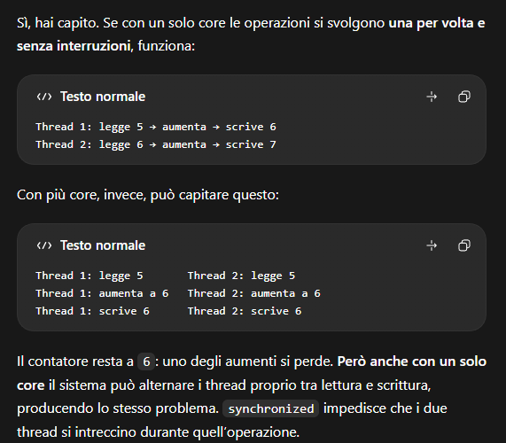
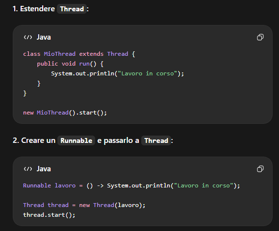
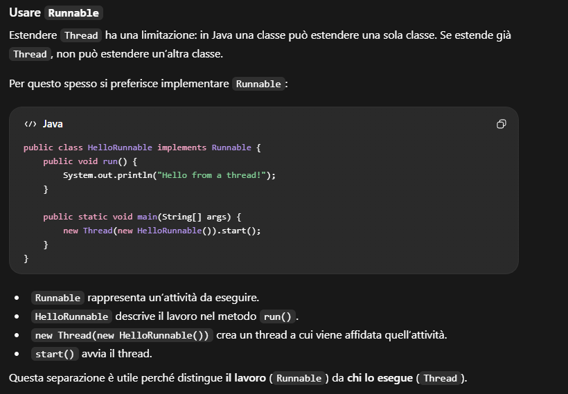
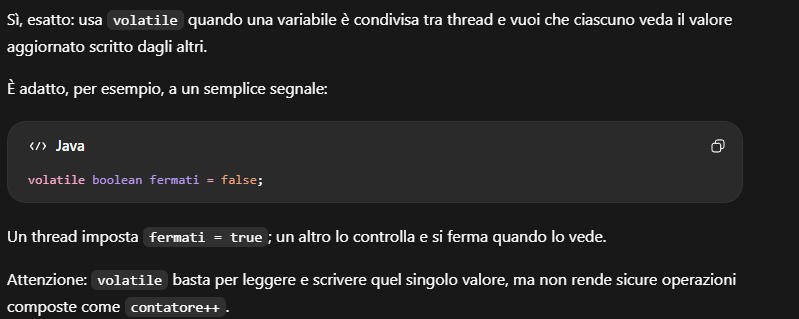
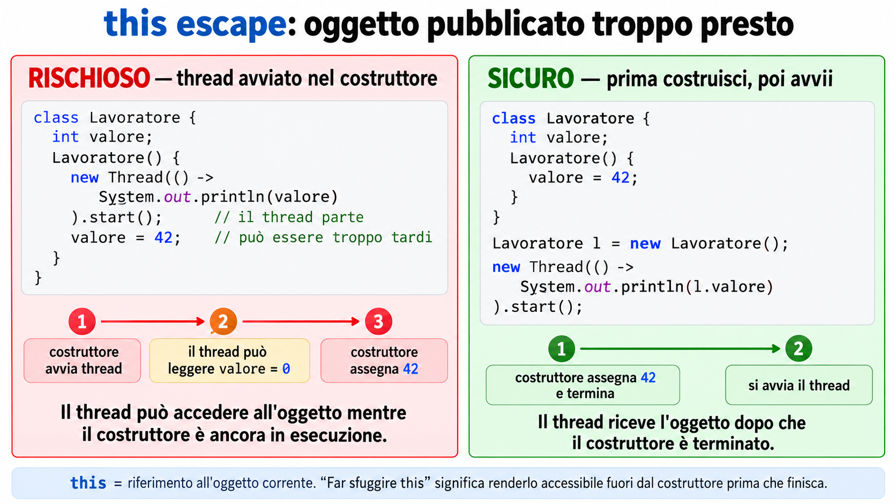

<h1 style="color:#C00000"><strong>THREAD — APPUNTI TEORICI</strong></h1>

<h2 style="color:#C00000"><strong>1. CORE, CONCORRENZA E PARALLELISMO</strong></h2>

Con l’aumento dei transistor non è sempre possibile continuare ad aumentare la frequenza di un singolo processore: il calore e il consumo diventano limiti importanti. Per aumentare le prestazioni si usano processori con più **core**.

I core possono condividere la memoria principale e possono avere cache proprie. Per sfruttare più core, il software deve dividere il lavoro in attività che possano procedere in modo indipendente.

- **Concorrenza:** più attività avanzano nello stesso intervallo di tempo, alternandosi o cooperando. Può esserci anche su un solo core tramite alternanza.
- **Parallelismo:** più attività vengono eseguite davvero nello stesso momento, per esempio su core distinti.

Con un solo core, il sistema alterna l’esecuzione dei thread. Con più core, thread diversi possono essere eseguiti contemporaneamente. In entrambi i casi, se condividono dati, devono essere coordinati.

<h3 style="color:#C00000"><strong>COSTI E DIFFICOLTÀ</strong></h3>

- **Context switch:** il sistema interrompe temporaneamente un’attività e riprende un’altra, salvando e ripristinando lo stato. Ha un costo.
- **Cache miss:** il dato richiesto non è nella cache e deve essere recuperato da un livello di memoria più lento.
- **Page fault:** un accesso richiede un intervento del sistema operativo sulla mappatura della memoria virtuale. Nel caso di una pagina non residente può richiedere un recupero lento dallo storage; non tutti i page fault implicano una lettura da disco.
- **Attesa e sincronizzazione:** un thread può dover aspettare una risorsa o un altro thread.

Questi fenomeni non sono esclusivi dei sistemi multicore, ma possono influenzare prestazioni e coordinamento quando si lavora in concorrenza.



<h2 style="color:#C00000"><strong>2. PROGRAMMAZIONE DISTRIBUITA, PROCESSI E THREAD</strong></h2>

- **Programmazione distribuita:** attività su computer diversi comunicano tramite rete.
- **Processi concorrenti:** programmi o processi diversi, gestiti dal sistema operativo, avanzano sulla stessa macchina. Ogni processo ha il proprio spazio di memoria.
- **Thread concorrenti:** flussi di esecuzione distinti all’interno dello stesso processo. Condividono memoria e risorse del processo, ma ciascuno esegue il proprio percorso di codice.

La memoria condivisa rende semplice scambiare dati fra thread, ma può provocare interferenze se più thread accedono agli stessi dati senza coordinamento.

<h2 style="color:#C00000"><strong>3. MULTITASKING E MULTITHREADING</strong></h2>

- **Multitasking:** il sistema operativo gestisce più programmi/processi, alternandone l’esecuzione e, se possibile, eseguendoli in parallelo.
- **Multithreading:** un singolo programma usa più thread per svolgere attività diverse, per esempio ricevere dati di rete, aggiornare l’interfaccia e controllare notifiche.

Ogni applicazione Java inizia con almeno il **main thread**. La JVM può inoltre creare thread di sistema.

<h2 style="color:#C00000"><strong>4. PROCESSO E THREAD</strong></h2>

Un **processo** è un programma in esecuzione con spazio di memoria e risorse proprie. Un **thread** è un flusso di esecuzione all’interno del processo.

I thread dello stesso processo condividono memoria e risorse (per esempio gli oggetti raggiungibili dall’heap), ma ognuno ha il proprio flusso di esecuzione e stack.

<h2 style="color:#C00000"><strong>5. CREARE E AVVIARE UN THREAD IN JAVA</strong></h2>

I tuoi appunti presentano **due modi** per avviare un thread.

**1. Estendere `Thread`**, ridefinendo `run()`:

```java
public class Lavoratore extends Thread {
    @Override
    public void run() {
        System.out.println("Lavoro in un nuovo thread");
    }

    public static void main(String[] args) throws InterruptedException {
        Lavoratore t = new Lavoratore();
        t.start();
        t.join();
    }
}
```

**2. Implementare `Runnable`** e passare l’attività a `Thread`, come nel frammento seguente. `Runnable` è spesso preferibile perché separa lavoro ed esecutore e una classe Java può estendere una sola classe. Un executor è un’ulteriore scelta di gestione delle attività.


```java
Runnable lavoro = () -> System.out.println("Attività in esecuzione");
Thread t = new Thread(lavoro);
t.start();
```

- `run()` contiene il lavoro da eseguire.
- `start()` avvia un nuovo thread; la JVM esegue `run()` su quel thread.
- Chiamare direttamente `run()` non crea un nuovo thread: è una normale chiamata di metodo nel thread corrente.
- Un oggetto `Thread` terminato non può essere riavviato chiamando di nuovo `start()`.

Per applicazioni reali, `ExecutorService` e altri strumenti del package `java.util.concurrent` aiutano a gestire gruppi di attività senza creare manualmente un thread per ogni lavoro.





<h2 style="color:#C00000"><strong>6. SOSPENSIONE, INTERRUZIONE E ATTESA</strong></h2>

<h3 style="color:#C00000"><strong><code>sleep()</code></strong></h3>

`Thread.sleep(millisecondi)` sospende temporaneamente il thread che sta eseguendo quella riga. Non sospende automaticamente tutti gli altri thread. Può lanciare `InterruptedException` se il thread viene interrotto durante l’attesa.

`sleep()` non rilascia i monitor/lock `synchronized` che il thread possiede.

<h3 style="color:#C00000"><strong><code>interrupt()</code></strong></h3>

`interrupt()` è una richiesta/segnalazione al thread, non un comando generale per ucciderlo. Il thread deve collaborare controllando il segnale o reagendo alle operazioni interrompibili.

- `Thread.currentThread().isInterrupted()` legge il flag senza azzerarlo.
- `Thread.interrupted()` legge il flag del thread corrente e lo azzera.
- Se il thread è bloccato in `sleep()`, `wait()` o `join()`, l’interruzione normalmente fa terminare l’attesa con `InterruptedException`; in tale caso il flag viene azzerato.

Se un metodo non può gestire l’interruzione, in genere deve ripristinare il flag con `Thread.currentThread().interrupt()` e lasciare che il livello superiore decida come terminare.

<h3 style="color:#C00000"><strong><code>join()</code> E <code>isAlive()</code></strong></h3>

`join()` fa aspettare il thread chiamante finché il thread indicato termina. `join(timeout)` con un timeout positivo attende al massimo il tempo specificato (`join(0)` equivale a un’attesa senza limite): il timeout limita l’attesa del chiamante, ma non interrompe il thread osservato.

`isAlive()` restituisce `true` se il thread è stato avviato e non è ancora terminato. `join()` può a sua volta lanciare `InterruptedException` se viene interrotto il thread che sta aspettando.

<h3 style="color:#C00000"><strong>ATTESA CON SCADENZA E RICHIESTA DI ARRESTO</strong></h3>

Un programma può attendere un thread con timeout ripetuti, controllare se è ancora attivo e, superata una scadenza, chiamare `interrupt()`. Poi può usare `join()` per aspettare la conclusione effettiva. L’interruzione è una richiesta: il thread deve reagire, per esempio uscendo da `sleep()` e terminando in modo ordinato.

<h2 style="color:#C00000"><strong>7. STATI E CICLO DI VITA DI UN THREAD</strong></h2>

Il modello concettuale spesso descritto è: creato, pronto, in esecuzione, in attesa o bloccato, terminato. In Java, `Thread.State` espone questi stati:

- **NEW:** thread creato ma non ancora avviato;
- **RUNNABLE:** thread avviato ed eseguibile; la JVM non distingue qui lo stato “ready” dall’esecuzione effettiva su CPU;
- **BLOCKED:** attende di acquisire un monitor `synchronized` già posseduto da un altro thread;
- **WAITING:** attende senza scadenza, per esempio su `wait()`, `join()` senza timeout o `LockSupport.park()`;
- **TIMED_WAITING:** attende con scadenza, per esempio su `sleep()`, `wait(timeout)`, `join(timeout)`, `LockSupport.parkNanos()` o `parkUntil()`;
- **TERMINATED:** esecuzione terminata.

`Thread.yield()` suggerisce allo scheduler che il thread corrente può cedere la CPU. È solo un suggerimento: non garantisce che il thread cambi stato o che un altro thread venga eseguito immediatamente.

In `WAITING`, un thread può essere risvegliato da notifiche, dalla fine del thread atteso o da altre operazioni previste dal meccanismo usato: per esempio `LockSupport.unpark(thread)` per una sospensione con `park()`. Il risveglio non implica che inizi subito a eseguire: deve prima soddisfare le condizioni necessarie (per esempio riacquisire il lock) e ottenere tempo CPU.

<h2 style="color:#C00000"><strong>8. CONDIVISIONE DEI DATI, INTERFERENZA E RACE CONDITION</strong></h2>

I thread possono accedere agli stessi oggetti e alle stesse variabili. Se il risultato dipende dall’ordine in cui operazioni di thread diversi vengono eseguite, si ha una **race condition**.

Un’operazione che sembra singola nel codice può essere composta da più passi. Per esempio, `contatore++` equivale concettualmente a leggere il valore, incrementarlo e scriverlo. Due thread possono sovrapporre questi passi e perdere un aggiornamento.

La **visibilità della memoria** è un problema distinto: un thread può non vedere subito le scritture di un altro se il programma non usa una relazione di sincronizzazione prevista dal modello di memoria Java.

<h2 style="color:#C00000"><strong>9. RELAZIONI HAPPENS-BEFORE</strong></h2>

Una relazione **happens-before** ordina operazioni e rende visibili gli effetti delle scritture tra thread. Tra gli esempi principali:

- Le operazioni eseguite prima di `Thread.start()` sono visibili al thread avviato.
- Le operazioni del thread terminato sono visibili al thread che ha atteso con successo la sua fine tramite `join()`.
- Un thread che rilascia un monitor e un altro che poi acquisisce lo stesso monitor hanno una relazione di visibilità.
- Una scrittura su una variabile `volatile` è visibile alle letture successive di quella stessa variabile secondo le regole del modello di memoria.

<h3 style="color:#C00000"><strong>ESEMPI ORIGINALI: VISIBILITÀ DI start() E join()</strong></h3>

Frammenti da inserire in un metodo `main` che dichiara o gestisce `InterruptedException`:

```java
int dato = 42;
Thread t = new Thread(() -> System.out.println(dato));
t.start();
t.join();
```

Il valore preparato prima di `start()` è visibile al nuovo thread. Per leggere invece un risultato scritto dal thread, attendi la sua terminazione:

```java
int[] risultato = {0};
Thread t = new Thread(() -> risultato[0] = 42);
t.start();
t.join();
System.out.println(risultato[0]); // 42
```

Un `join(timeout)` che scade mentre il thread è ancora vivo non dà la garanzia della sua terminazione: ricontrolla `isAlive()`.

<h3 style="color:#C00000"><strong><code>volatile</code></strong></h3>

`volatile` assicura visibilità e ordinamento per accessi alla variabile volatile, ed è utile come segnale semplice:

```java
public class Segnale {
    private volatile boolean pronto = false;
    private int dato;

    public void produci() {
        dato = 42;
        pronto = true;
    }

    public void consuma() {
        if (pronto) {
            System.out.println(dato); // 42 se ha osservato pronto == true
        }
    }

    public static void main(String[] args) throws InterruptedException {
        Segnale stato = new Segnale();
        Thread produttore = new Thread(stato::produci);
        Thread consumatore = new Thread(stato::consuma);
        produttore.start();
        consumatore.start();
        produttore.join();
        consumatore.join();
    }
}
```

`volatile` si applica qui a un **campo dell’oggetto condiviso**, non a una variabile locale del `main`. Il consumatore potrebbe eseguire il controllo prima del produttore e non stampare nulla: il flag garantisce la visibilità quando legge `true`, non l’ordine di scheduling né un’attesa automatica.

Per un segnale di arresto, l’altro esempio dei tuoi appunti è:

```java
public class ArrestoVolatile implements Runnable {
    private volatile boolean fermati = false;

    public void chiediArresto() {
        fermati = true;
    }

    @Override
    public void run() {
        while (!fermati) {
            // Un piccolo passo di lavoro; ciclo attivo solo a scopo didattico.
        }
    }
}
```

Il segnale viene controllato tra un passo e l’altro; non sblocca da solo operazioni di I/O o altre attese.

`volatile` non rende atomiche operazioni composte. Per esempio `volatile int contatore; contatore++;` può perdere incrementi perché l’incremento consiste di lettura, calcolo e scrittura.



<h2 style="color:#C00000"><strong>10. SINCRONIZZAZIONE E MONITOR</strong></h2>

Ogni oggetto Java ha un **lock intrinseco**, detto anche monitor. Un metodo o blocco `synchronized` acquisisce il monitor associato, esegue la sezione protetta e lo rilascia quando esce, anche se esce per un’eccezione.

Se un altro thread richiede lo stesso monitor mentre è occupato, resta in stato `BLOCKED` finché può acquisirlo.

```java
synchronized (this) {
    nameCount++;
    nameList.add(name);
}
```

Il blocco protegge solo il codice al suo interno e solo rispetto ai thread che usano **lo stesso lock**. Due oggetti distinti hanno monitor distinti.

- Un metodo di istanza `synchronized` usa come lock `this`.
- Un metodo `static synchronized` usa come lock l’oggetto `NomeClasse.class`.
- Un metodo statico sincronizzato e un metodo sincronizzato su una singola istanza usano lock diversi e possono quindi procedere contemporaneamente.

I costruttori non possono essere dichiarati `synchronized`. È comunque importante non rendere un oggetto visibile ad altri thread prima che la sua costruzione sia terminata. Se il costruttore avvia un thread che usa `this`, oppure registra `this` in un oggetto condiviso, l’istanza può “sfuggire” prima che i campi siano inizializzati: si parla di **leaking this/escape**. Completa prima la costruzione, poi pubblica l’oggetto o avvia il thread.



<h2 style="color:#C00000"><strong>11. SINCRONIZZAZIONE A GRANA FINE</strong></h2>

Si può proteggere solo la parte di codice che accede ai dati condivisi, invece di sincronizzare un metodo intero. Lock distinti possono permettere parallelismo quando proteggono dati indipendenti:

```java
synchronized (lock1) {
    c1++;
}

synchronized (lock2) {
    c2++;
}
```

La scelta del lock deve riflettere quali dati protegge. Più lock possono aumentare la concorrenza, ma rendono più complesso prevenire deadlock. Tutti gli accessi a uno stesso stato condiviso devono seguire una strategia coerente.

<h2 style="color:#C00000"><strong>12. OPERAZIONI ATOMICHE</strong></h2>

Un’operazione atomica appare come una singola azione indivisibile agli altri thread. `AtomicInteger` (da importare con `java.util.concurrent.atomic.AtomicInteger`) offre operazioni atomiche come `incrementAndGet()`. I campi e i metodi seguenti appartengono a una classe:

```java
private final AtomicInteger c = new AtomicInteger(0);

public void increment() {
    c.incrementAndGet();
}

public int value() {
    return c.get();
}
```

È diverso da `volatile int c; c++`: `volatile` dà visibilità, ma non rende atomico l’incremento.

<h2 style="color:#C00000"><strong>13. DEADLOCK, STARVATION E LIVELOCK</strong></h2>

- **Deadlock:** due o più thread si attendono reciprocamente per lock che gli altri possiedono; nessuno può proseguire.
- **Starvation:** un thread non ottiene a lungo una risorsa o tempo CPU sufficiente, mentre altri continuano.
- **Livelock:** i thread sono attivi e reagiscono l’uno all’altro, ma le loro azioni impediscono il completamento del lavoro.

<h2 style="color:#C00000"><strong>14. LEGGE DI AMDAHL</strong></h2>

La legge di Amdahl stima il limite al guadagno ottenibile parallelizzando un programma:

$$
S = \frac{1}{(1-p)+\frac{p}{n}}
$$

- `S`: velocità relativa rispetto all’esecuzione con un solo processore;
- `p`: frazione parallelizzabile;
- `1-p`: frazione sequenziale;
- `n`: numero di processori.

Se il 90% del lavoro è parallelizzabile e si usano 4 processori:

$$
S = \frac{1}{0{,}1+\frac{0{,}9}{4}} \approx 3{,}08
$$

Il programma è circa 3,08 volte più veloce, non 4 volte: la parte sequenziale limita il guadagno massimo.

<h2 style="color:#C00000"><strong>15. SINGLETON E CONCORRENZA</strong></h2>

Un **Singleton** è una classe progettata per fornire una sola istanza condivisa. Esempi possibili sono una configurazione comune, un logger condiviso o un gestore di una risorsa unica. Non tutte le classi devono essere Singleton: se servono oggetti distinti (per esempio più studenti), si creano normalmente più istanze.

<h3 style="color:#C00000"><strong>INIZIALIZZAZIONE LAZY NON SINCRONIZZATA</strong></h3>

```java
class Singleton {
    private static Singleton instance;
    private Singleton() {}

    public static Singleton getInstance() {
        if (instance == null) {
            instance = new Singleton();
        }
        return instance;
    }
}
```

Questa versione crea l’istanza solo alla prima richiesta, ma non è thread-safe: due thread possono vedere `null` e creare due oggetti.

- `private static instance` conserva il riferimento a livello di classe.
- Il costruttore `private` impedisce l’uso normale di `new Singleton()` dall’esterno.
- `getInstance()` è il punto di accesso previsto.
- Con due thread: A legge `null`, B legge `null`, A costruisce un oggetto, B ne costruisce un altro. Il controllo e la costruzione devono quindi essere coordinati.


<h3 style="color:#C00000"><strong>SINCRONIZZARE IL METODO</strong></h3>

Dichiarare `getInstance()` `static synchronized` impedisce creazioni concorrenti e garantisce una sola istanza, ma ogni chiamata deve acquisire il lock anche dopo la creazione.

Metodo da inserire nella precedente classe `Singleton`, al posto della versione non sincronizzata:

```java
public static synchronized Singleton getInstance() {
    if (instance == null) {
        instance = new Singleton();
    }
    return instance;
}
```


<h3 style="color:#C00000"><strong>DOUBLE-CHECKED LOCKING</strong></h3>

La forma classica richiede che il campo sia `volatile`:

```java
class Singleton {
    private static volatile Singleton instance;
    private Singleton() {}

    public static Singleton getInstance() {
        if (instance == null) {
            synchronized (Singleton.class) {
                if (instance == null) {
                    instance = new Singleton();
                }
            }
        }
        return instance;
    }
}
```

Il controllo esterno evita il lock dopo la creazione; quello interno ricontrolla il valore dopo aver acquisito il lock. `volatile` garantisce la corretta visibilità/pubblicazione in Java moderno.

<h3 style="color:#C00000"><strong>LAZY HOLDER</strong></h3>

Un’alternativa semplice e thread-safe usa l’inizializzazione della classe interna:

```java
public class Something {
    private Something() {}

    private static class LazyHolder {
        private static final Something INSTANCE = new Something();
    }

    public static Something getInstance() {
        return LazyHolder.INSTANCE;
    }
}
```

La JVM inizializza la classe interna al primo uso e garantisce l’inizializzazione thread-safe. Per molte applicazioni è l’approccio preferibile rispetto a gestire manualmente lock e `volatile`.

Passaggi da ricordare: caricare `Something` non inizializza immediatamente `LazyHolder`; il primo `getInstance()` usa il campo `LazyHolder.INSTANCE`; l’inizializzazione della classe interna costruisce l’istanza una sola volta e la pubblica in sicurezza; le chiamate successive restituiscono lo stesso riferimento. La sola istanza non rende però automaticamente thread-safe i successivi metodi mutabili del Singleton.


<h2 style="color:#C00000"><strong>ESEMPI DI COORDINAMENTO TRA THREAD</strong></h2>

<h3 style="color:#C00000"><strong>CONTROLLARE UN THREAD CON <code>isAlive()</code> E <code>join(timeout)</code></strong></h3>

Ripresa dell’esempio `MessageLoop`: il thread principale può verificare periodicamente se il thread di lavoro è terminato. Nel frammento `lavoro` è già avviato e il metodo chiamante gestisce o dichiara `InterruptedException`. `join(1000)` aspetta al massimo un secondo e poi ritorna, anche se il thread è ancora attivo:

```java
long inizio = System.currentTimeMillis();
long pazienza = 5000;

while (lavoro.isAlive()) {
    lavoro.join(1000);
    if (System.currentTimeMillis() - inizio > pazienza
            && lavoro.isAlive()) {
        System.out.println("Tired of waiting!");
        lavoro.interrupt();       // richiesta di arresto
        lavoro.join();            // attende la fine effettiva
    }
}
System.out.println("Finally!");
```

`interrupt()` non garantisce che il thread termini: il codice di `lavoro` deve reagire. Nell’esempio didattico, se è in `sleep()`, riceve `InterruptedException` e può terminare. Senza gestione dell’interruzione, `join()` può continuare ad aspettare.

<h3 style="color:#C00000"><strong><code>wait()</code>, <code>notify()</code> E <code>notifyAll()</code></strong></h3>

Questi metodi coordinano thread che condividono lo stesso monitor:

- `wait()` sospende il thread e **rilascia il monitor**; prima di tornare, il thread deve riacquisirlo;
- `notify()` risveglia uno dei thread in attesa su quel monitor;
- `notifyAll()` risveglia tutti i thread in attesa; poi competono per riacquisire il monitor.

La notifica non trasferisce il lock al thread risvegliato e non lo fa eseguire immediatamente. Si ricontrolla la condizione con `while`, non `if`, perché il thread può risvegliarsi quando la condizione non è più vera o ricevere un risveglio spurio.

```java
synchronized (lock) {
    while (!datoDisponibile) {
        lock.wait();
    }
    usaDato();
}
```

Il thread che produce il dato aggiorna la condizione sotto lo stesso lock e poi notifica:

```java
synchronized (lock) {
    preparaDato();
    datoDisponibile = true;
    lock.notifyAll();
}
```

`wait()`, `notify()` e `notifyAll()` devono essere invocati mentre si possiede il monitor di quell’oggetto; altrimenti viene lanciata `IllegalMonitorStateException`.

<h2 style="color:#C00000"><strong>ESEMPIO DI RACE CONDITION E SINCRONIZZAZIONE</strong></h2>

Un contatore condiviso aggiornato da due thread con `count++` può perdere incrementi, perché l’incremento non è atomico:

```java
class Contatore {
    private int valore;

    public synchronized void incrementa() {
        valore++;
    }

    public synchronized int valore() {
        return valore;
    }
}
```

Qui entrambi i metodi sincronizzati usano lo stesso lock dell’istanza. In alternativa si può usare `AtomicInteger` se basta l’incremento atomico. La scelta dipende dall’operazione da proteggere, non dal fatto che una variabile sia semplicemente dichiarata `volatile`.

<h2 style="color:#C00000"><strong>LOCK, SINCRONIZZAZIONE STATICA E GRANA FINE</strong></h2>

```java
class Dati {
    private final Object lockUno = new Object();
    private final Object lockDue = new Object();
    private int c1;
    private int c2;

    void incrementaC1() {
        synchronized (lockUno) { c1++; }
    }

    void incrementaC2() {
        synchronized (lockDue) { c2++; }
    }
}
```

I due aggiornamenti possono procedere contemporaneamente perché usano monitor differenti. Se le variabili non fossero indipendenti, lock separati potrebbero invece lasciare dati incoerenti.

```java
static synchronized void metodoDiClasse() { }
```

Equivalenza del monitor da individuare negli esercizi:

```java
public class NomeClasse {
    public static synchronized void foo() {
        // Usa il monitor NomeClasse.class.
    }

    public static void formaEquivalente() {
        synchronized (NomeClasse.class) {
            // Usa lo stesso monitor di foo().
        }
    }
}
```

Il lock di un metodo statico sincronizzato è `NomeClasse.class`, non `this`. Un metodo di istanza sincronizzato blocca la singola istanza. Per questo i due tipi di metodo possono essere eseguiti contemporaneamente.

<h2 style="color:#C00000"><strong>ESEMPI DI DEADLOCK E ORDINE DEI LOCK</strong></h2>

Un possibile deadlock si presenta così:

```text
Thread A: acquisisce lock1 → attende lock2
Thread B: acquisisce lock2 → attende lock1
```

Nessuno può proseguire. Una regola pratica è acquisire sempre i lock multipli nello stesso ordine in tutti i thread. Ridurre il numero di lock e non chiamare codice esterno mentre si possiede un lock può diminuire il rischio, ma il disegno va comunque verificato.

<h2 style="color:#C00000"><strong>SINGLETON: CONFRONTO DEGLI APPROCCI</strong></h2>

- **Lazy non sincronizzato:** crea l’oggetto solo al primo uso, ma più thread possono crearne due.
- **`static synchronized`:** è semplice e sicuro, ma blocca tutte le chiamate a `getInstance()`.
- **Double-checked locking:** riduce l’acquisizione del lock successiva alla creazione, ma richiede il campo `volatile` e il secondo controllo dentro il lock.
- **Lazy holder:** sfrutta l’inizializzazione thread-safe delle classi Java e crea l’istanza al primo accesso al holder.
- **Enum singleton:** per molti singleton semplici è un’alternativa concisa e sicura, se compatibile con il requisito.

Il Singleton è adatto solo quando il dominio richiede davvero una singola istanza condivisa. Non va imposto a classi che devono avere molte istanze indipendenti.

<h2 style="color:#C00000"><strong>PUNTI ESSENZIALI PER L’ESAME</strong></h2>

- Distingui **concorrenza** (attività che avanzano nello stesso periodo) da **parallelismo** (esecuzione simultanea su più core).
- Spiega la differenza tra processo, thread e memoria condivisa.
- Distingui `run()` da `start()` e spiega perché un thread terminato non si riavvia.
- Spiega cosa fanno `sleep()`, `interrupt()` e `join()`, inclusa la natura cooperativa dell’interruzione.
- Riconosci gli stati Java `NEW`, `RUNNABLE`, `BLOCKED`, `WAITING`, `TIMED_WAITING`, `TERMINATED`.
- Spiega race condition, visibilità e relazione happens-before; `volatile` non rende atomico `count++`.
- Identifica il monitor usato da un metodo `synchronized` di istanza, da uno statico e da un blocco esplicito.
- Distingui deadlock, starvation e livelock.
- Applica la legge di Amdahl e spiega perché la parte sequenziale limita il guadagno.

<h2 style="color:#C00000"><strong>DOMANDE ORIGINALI DEL VAULT: THREAD E SINCRONIZZAZIONE</strong></h2>

Tutte le 56 domande e risposte del tuo file `2 DOMANDE/3 THREAD.md`, incluse le combinazioni di lock di istanza/statici e le varianti del Singleton.

<h3 style="color:#C00000"><strong>T1. QUAL È LA DIFFERENZA TRA UN PROCESSO E UN THREAD? E QUALI SONO LE SOMIGLIANZE?</strong></h3>

Un processo è un programma in esecuzione con il proprio spazio di memoria e le proprie risorse. Un thread è un flusso di esecuzione dentro un processo.
`Thread` dello stesso processo condividono heap e risorse, ma ciascuno ha il proprio stack e il proprio contesto di esecuzione. Processi e thread eseguono istruzioni e possono essere pianificati dal sistema operativo; processi diversi sono però più isolati tra loro.

<h3 style="color:#C00000"><strong>T2. PERCHÉ DIRE CHE UN THREAD È UN «PROCESSO LIGHT-WEIGHT» È TECNICAMENTE SCORRETTO, ANCHE SE È UN’ESPRESSIONE DIFFUSA?</strong></h3>

È un paragone informale che allude al fatto che creare e passare da un thread può costare meno che fare lo stesso con un processo. Tecnicamente, però, il processo è un contenitore di risorse e di memoria isolata, mentre il thread è un flusso di esecuzione che vive dentro quel contenitore. Un thread non è un processo più piccolo: è un’entità diversa, con risorse condivise con gli altri thread del processo.

<h3 style="color:#C00000"><strong>T3. QUALI SONO ESEMPI DI APPLICAZIONI CHE HANNO NECESSITÀ DI ESSERE MULTITHREAD?</strong></h3>

Un server può gestire più richieste contemporaneamente; un’interfaccia grafica può restare reattiva mentre svolge un lavoro lungo; un browser può caricare più contenuti; un gioco può separare grafica, input e simulazione; un’app può scaricare un file mentre permette all’utente di continuare a usarla. Il multithreading è utile quando ci sono attività indipendenti o attese che possono sovrapporsi.

<h3 style="color:#C00000"><strong>T4. COME USA UN SERVER IL POOL DI THREAD PER OTTIMIZZARE LE PRESTAZIONI?</strong></h3>

Il server mantiene un insieme di thread già creati. Quando arriva una richiesta, la assegna a un thread disponibile; terminato il lavoro, quel thread torna nel pool.
Così si evita di creare e distruggere un thread per ogni richiesta e si limita il numero di lavori simultanei, contenendo l’uso di memoria e CPU. Se tutti i thread sono occupati, le richieste possono attendere in una coda o essere rifiutate secondo la configurazione.

<h3 style="color:#C00000"><strong>T5. ILLUSTRARE IL DIAGRAMMA DEGLI STATI DI UN THREAD IN JAVA</strong></h3>

Il diagramma didattico mostra: New, `Runnable`, Waiting, Timed Waiting, Blocked e Terminated. `Runnable` viene spesso disegnato come Ready (pronto, in attesa della CPU) e Running (in esecuzione sulla CPU).
Un thread creato è New; dopo `start()` diventa eseguibile. Durante il lavoro può attendere una notifica, un tempo o un lock. Quando `run()` termina, diventa Terminated. Nella API Java, invece, Ready e Running non sono stati distinti: entrambi rientrano in `RUNNABLE`.

<h3 style="color:#C00000"><strong>T6. COME SI PUÒ CREARE UN THREAD IN JAVA E QUALI SONO I VANTAGGI E GLI SVANTAGGI DELLE DUE TECNICHE POSSIBILI?</strong></h3>

Le due tecniche classiche sono estendere `Thread` oppure implementare `Runnable`.

- Estendere `Thread`: si ridefinisce `run()` e si chiama `start()` sull’oggetto. È semplice, ma la classe non può estendere un’altra classe e il compito è legato direttamente al thread.
- Implementare `Runnable`: si definisce il compito in `run()` e lo si passa a un `Thread`. Separa il lavoro dal meccanismo di esecuzione, permette di estendere un’altra classe e si integra meglio con i pool. In genere è la scelta preferibile.

In entrambi i casi, per avviare un nuovo flusso si chiama `start()`, non `run()` direttamente.

<h3 style="color:#C00000"><strong>T7. QUANDO SI INVOCA IL METODO <code>start()</code> SU UN THREAD, COSA SUCCEDE?</strong></h3>

`start()` chiede alla JVM di avviare un nuovo flusso di esecuzione. Il thread diventa eseguibile e la JVM/sistema operativo lo pianifica; a un certo punto viene chiamato `run()` su quel nuovo flusso. `start()` ritorna senza aspettare che `run()` finisca. Sullo stesso oggetto `Thread` si può chiamare `start()` una sola volta.

<h3 style="color:#C00000"><strong>T8. QUANDO SI INVOCA IL METODO <code>run()</code> SU UN THREAD, COSA SUCCEDE?</strong></h3>

Se si chiama `run()` direttamente, il suo codice viene eseguito come una normale chiamata di metodo nel thread corrente. Non viene creato né avviato un nuovo flusso. Il chiamante prosegue solo quando `run()` ritorna, come accade per qualunque chiamata sincrona.

<h3 style="color:#C00000"><strong>T9. QUANDO SI INVOCA <code>start()</code> SU UN THREAD, IL THREAD VIENE ESEGUITO: VERO O FALSO?</strong></h3>

Vero nel senso che `start()` avvia un nuovo flusso e rende il thread eseguibile. Non significa che il suo codice venga eseguito immediatamente: il momento in cui riceve la CPU dipende dallo scheduler.

<h3 style="color:#C00000"><strong>T10. QUANDO SI INVOCA <code>run()</code> SU UN THREAD, IL THREAD VIENE ESEGUITO: VERO O FALSO?</strong></h3>

Dipende da cosa si intende. Il codice di `run()` viene eseguito se lo si chiama, ma viene eseguito dal thread chiamante. Non parte un nuovo thread. Per avviare un flusso separato bisogna chiamare `start()`.

<h3 style="color:#C00000"><strong>T11. QUAL È LA DIFFERENZA TRA I METODI <code>run()</code> E <code>start()</code> DI UN THREAD?</strong></h3>

`run()` contiene il compito da eseguire. `start()` avvia un nuovo flusso e fa sì che la JVM invochi `run()` su quel flusso. Chiamare `run()` direttamente è una normale chiamata di metodo; chiamare `start()` avvia un thread distinto.

<h3 style="color:#C00000"><strong>T12. COSA SONO GLI INTERRUPT SU UN THREAD E QUALI METODI SONO A DISPOSIZIONE PER TRATTARLI O GESTIRLI?</strong></h3>

Un interrupt è una richiesta cooperativa a un thread di interrompere o rivedere il proprio lavoro: non lo uccide forzatamente. Si invia con `interrupt()`. Si può controllare il flag con `isInterrupted()`; `Thread.interrupted()` controlla il thread corrente e azzera il flag.
Se il thread è in `sleep()`, `wait()` o `join()`, l’interrupt può far lanciare InterruptedException; il codice deve catturarla o dichiararla. Spesso, se non può gestirla lì, la ricattiva con `Thread.currentThread().interrupt()` e poi termina o propaga la richiesta.

<h3 style="color:#C00000"><strong>T13. QUALI SONO GLI STATI DEL DIAGRAMMA DI STATO DI UN THREAD?</strong></h3>

Gli stati ufficiali di `Thread.State` sono `NEW`, `RUNNABLE`, `BLOCKED`, `WAITING`, `TIMED_WAITING` e `TERMINATED`. `RUNNABLE` comprende sia il thread pronto sia quello che sta effettivamente usando la CPU. Il diagramma delle dispense separa concettualmente Ready e Running, ma Java non li espone come stati distinti.

<h3 style="color:#C00000"><strong>T14. COME PASSA UN THREAD DALLO STATO NEW A <code>Runnable</code>?</strong></h3>

Dopo la creazione, per esempio con `new Thread(compito)`, il thread è `NEW`. La chiamata `t.start()` lo rende eseguibile e lo porta a `RUNNABLE`. Il thread non può essere riavviato chiamando `start()` una seconda volta.

<h3 style="color:#C00000"><strong>T15. COME PASSA UN THREAD DA <code>Runnable</code> A TIMED WAITING E COME NE ESCE?</strong></h3>

Entra in `TIMED_WAITING` quando attende per un tempo limitato, per esempio con `Thread.sleep(tempo)`, `wait(tempo)`, `join(tempo)`, o con alcune operazioni di LockSupport. Esce allo scadere del tempo o quando viene risvegliato/interrotto, a seconda del metodo. Può poi tornare eseguibile; se deve riacquisire un lock, potrebbe dover attendere ancora.

<h3 style="color:#C00000"><strong>T16. COME PASSA UN THREAD DA <code>Runnable</code> A WAITING E COME NE ESCE?</strong></h3>

Può entrare in `WAITING` chiamando `wait()` senza timeout, `join()` senza timeout o LockSupport.`park()`. Si risveglia, rispettivamente, con `notify()`/`notifyAll()` (poi deve riacquisire il monitor), con la terminazione del thread atteso o con un `unpark()`/interrupt secondo il meccanismo usato. Dopo il risveglio può dover competere per un lock prima di proseguire.

<h3 style="color:#C00000"><strong>T17. COME PASSA UN THREAD DA <code>Runnable</code> A BLOCKED E COME NE ESCE?</strong></h3>

Diventa `BLOCKED` quando cerca di entrare in una sezione `synchronized` il cui monitor è già posseduto da un altro thread. Esce da `BLOCKED` quando ottiene quel monitor, cioè quando l’altro thread lo rilascia. `BLOCKED` indica l’attesa per entrare in un monitor, non ogni possibile attesa di risorsa.

<h3 style="color:#C00000"><strong>T18. PERCHÉ LO STATO <code>Runnable</code> È STRUTTURATO NEI SOTTOSTATI READY E RUNNING E COME SI PASSA DALL’UNO ALL’ALTRO?</strong></h3>

È una distinzione utile per spiegare la pianificazione: Ready significa che il thread può correre ma aspetta la CPU; Running significa che in quel momento usa la CPU. Lo scheduler può selezionarlo (Ready → Running) o sospenderlo/preemptarlo (Running → Ready). Sono sottostati concettuali: la API Java li riunisce in `RUNNABLE`.

<h3 style="color:#C00000"><strong>T19. QUALI SONO I POSSIBILI TIPI DI ERRORE GENERATI DAI THREAD?</strong></h3>

Tra i problemi tipici ci sono interferenza tra operazioni, race condition, visibilità o inconsistenza della memoria, deadlock, starvation e livelock. Possono inoltre verificarsi eccezioni nel codice del thread. Non tutti sono errori lanciati come eccezioni: molti sono comportamenti errati del programma che dipendono dall’interleaving.

<h3 style="color:#C00000"><strong>T20. CHE COS’È L’INTERFERENZA TRA THREAD E COME SI RISOLVE?</strong></h3>

È l’intreccio di operazioni concorrenti su uno stesso dato che porta a un risultato scorretto. Per esempio, due incrementi possono leggere entrambi 5 e scrivere entrambi 6, perdendo un incremento.
Si risolve proteggendo l’intera operazione con lo stesso lock (per esempio `synchronized`) oppure usando un’operazione atomica, come `AtomicInteger.incrementAndGet()`.

<h3 style="color:#C00000"><strong>T21. CHE COS’È L’INCONSISTENZA DELLA MEMORIA E COME SI RISOLVE?</strong></h3>

È il problema per cui un thread non ha una garanzia di vedere una modifica fatta da un altro thread, o non vede in modo coerente i dati associati. Il codice può avere una race di visibilità.
Si stabilisce una relazione di sincronizzazione: per esempio con `synchronized` sullo stesso monitor, con una variabile `volatile` usata correttamente, oppure con `start()`, `join()` e strumenti concorrenti che documentano le proprie garanzie.

<h3 style="color:#C00000"><strong>T22. CHE COS’È UNA RACE CONDITION?</strong></h3>

È una condizione in cui il risultato dipende dall’ordine o dai tempi con cui thread diversi eseguono operazioni concorrenti. Se quell’ordine non è controllato e influisce sulla correttezza, il programma può produrre risultati diversi o sbagliati.

<h3 style="color:#C00000"><strong>T23. PERCHÉ I BUG DOVUTI A RACE CONDITION SONO PARTICOLARMENTE COMPLESSI DA TRATTARE?</strong></h3>

L’interleaving cambia da un’esecuzione all’altra; perciò il difetto può comparire solo raramente. Inoltre, log e debugger modificano i tempi e possono far sparire il problema. Per riprodurlo e correggerlo servono spesso ragionamento sulle interazioni e test ripetuti.

<h3 style="color:#C00000"><strong>T24. CHE COS’È LA RELAZIONE HAPPENS-BEFORE?</strong></h3>

È una relazione definita dal modello di memoria Java. Se un’azione A happens-before un’azione B, gli effetti di A sono visibili a B e l’ordine è garantito. Non significa necessariamente che A e B siano eseguite una subito dopo l’altra nel tempo.

<h3 style="color:#C00000"><strong>T25. COME FACCIO A STABILIRE UNA RELAZIONE HAPPENS-BEFORE?</strong></h3>

Esempi importanti:

- Le azioni del thread chiamante prima di `t.start()` happens-before le azioni eseguite dal nuovo thread.
- Le azioni di un thread prima della sua terminazione happens-before il ritorno da un `join()` riuscito su quel thread.
- Il rilascio di un monitor happens-before una successiva acquisizione dello stesso monitor.
- Una scrittura `volatile` happens-before una lettura successiva della stessa variabile `volatile`.

Anche le API concorrenti, come executor, future e collezioni concorrenti, forniscono garanzie specifiche.

<h3 style="color:#C00000"><strong>T26. CHE COSA SIGNIFICA CHE UNA VARIABILE IN MEMORIA È DICHIARATA <code>volatile</code>?</strong></h3>

`volatile` dice alla JVM che letture e scritture di quella variabile sono condivise tra thread: una lettura successiva può osservare la scrittura più recente secondo il modello di memoria, e si stabilisce anche l’ordinamento previsto dalla regola `volatile`. Non fa partire thread e non rende atomiche operazioni composte come x++.

<h3 style="color:#C00000"><strong>T27. PERCHÉ È NECESSARIA LA SINCRONIZZAZIONE?</strong></h3>

Quando più thread condividono dati modificabili, la sincronizzazione serve a coordinare gli accessi. Può impedire che operazioni si sovrappongano nella sezione critica e può stabilire visibilità e ordine tra le modifiche. Senza una regola condivisa, il programma può avere risultati errati o non prevedibili.

<h3 style="color:#C00000"><strong>T28. PERCHÉ È NECESSARIA UNA SINCRONIZZAZIONE EFFICIENTE?</strong></h3>

La sincronizzazione corretta può comunque far aspettare i thread. Se si blocca troppo codice o si usa un unico lock per dati indipendenti, si riduce il lavoro parallelo. Una sincronizzazione efficiente protegge ciò che serve per il tempo necessario, mantenendo la correttezza senza creare attese superflue.

<h3 style="color:#C00000"><strong>T29. CHE COSA SONO I METODI SINCRONIZZATI?</strong></h3>

Sono metodi dichiarati con `synchronized`. Un metodo `synchronized` di istanza acquisisce il monitor dell’oggetto corrente (this) per tutta la chiamata; un altro thread che richiede lo stesso monitor aspetta. Il monitor viene rilasciato all’uscita dal metodo, anche se termina con un’eccezione.

<h3 style="color:#C00000"><strong>T30. CHE COSA SONO I METODI STATICI SINCRONIZZATI?</strong></h3>

Sono metodi dichiarati static `synchronized`. Acquisiscono il monitor dell’oggetto Class della classe, per esempio NomeClasse.class, non il monitor di una singola istanza. I metodi statici `synchronized` della stessa classe usano quel monitor.

<h3 style="color:#C00000"><strong>T31. CHE RELAZIONE DI ACCESSO ESCLUSIVO HANNO UN METODO <code>synchronized</code> DI ISTANZA E UN METODO STATIC <code>synchronized</code>?</strong></h3>

Usano monitor diversi: il metodo di istanza usa this, mentre quello statico usa NomeClasse.class. Perciò, di per sé, non si bloccano a vicenda. Possono essere eseguiti contemporaneamente, salvo che il loro codice acquisisca anche un altro lock condiviso.

<h3 style="color:#C00000"><strong>T32. UN METODO <code>synchronized</code> DI ISTANZA BLOCCA UN ALTRO THREAD CHE ESEGUE UN METODO <code>synchronized</code> DI ISTANZA?</strong></h3>

Sì, se entrambi i metodi sono chiamati sulla stessa istanza: richiedono lo stesso monitor. Se sono chiamati su due oggetti diversi, i monitor sono diversi e non si bloccano per questo motivo.

<h3 style="color:#C00000"><strong>T33. UN METODO <code>synchronized</code> DI ISTANZA BLOCCA UN ALTRO THREAD CHE ESEGUE UN METODO STATIC <code>synchronized</code>?</strong></h3>

No, non per il solo fatto di essere `synchronized`: il primo usa il monitor dell’istanza, il secondo quello della classe. Potrebbero bloccarsi solo se il codice acquisisce anche un monitor comune.

<h3 style="color:#C00000"><strong>T34. UN METODO <code>synchronized</code> DI ISTANZA BLOCCA UN ALTRO THREAD CHE ESEGUE UN METODO STATICO NON <code>synchronized</code>?</strong></h3>

No. Il metodo statico non acquisisce automaticamente il monitor dell’istanza né quello della classe.

<h3 style="color:#C00000"><strong>T35. UN METODO <code>synchronized</code> DI ISTANZA BLOCCA UN ALTRO THREAD CHE ESEGUE UN METODO DI ISTANZA NON <code>synchronized</code>?</strong></h3>

No. Un metodo non `synchronized` non acquisisce automaticamente il monitor dell’oggetto. Può quindi essere eseguito mentre un altro thread è dentro un metodo `synchronized` della stessa istanza, salvo sincronizzazione esplicita nel suo codice.

<h3 style="color:#C00000"><strong>T36. UN METODO <code>synchronized</code> DI ISTANZA BLOCCA TUTTI I THREAD IN ESECUZIONE SULLA JVM?</strong></h3>

No. Blocca soltanto i thread che cercano di acquisire lo stesso monitor. Gli altri thread possono eseguire codice che non richiede quel monitor.

<h3 style="color:#C00000"><strong>T37. UN METODO <code>synchronized</code> DI ISTANZA BLOCCA TUTTI I THREAD IN ESECUZIONE SU TUTTE LE JVM DELLA MACCHINA?</strong></h3>

No. I monitor Java sono locali alla singola JVM e al relativo oggetto. Non coordinano automaticamente processi JVM distinti.

<h3 style="color:#C00000"><strong>T38. UN METODO <code>synchronized</code> DI ISTANZA BLOCCA TUTTI I THREAD DI TUTTE LE JVM SU TUTTI I COMPUTER?</strong></h3>

No. Un lock Java non è un lock distribuito: non coordina computer diversi né JVM diverse. Per coordinare processi remoti serve un meccanismo apposito, per esempio un servizio o lock distribuito.

<h3 style="color:#C00000"><strong>T39. UN METODO <code>synchronized</code> DI ISTANZA BLOCCA TUTTI I THREAD DI TUTTE LE JVM DEI COMPUTER DELL’UNIVERSITÀ?</strong></h3>

No. Vale solo per i thread che tentano di acquisire lo stesso monitor nella stessa JVM. Il numero o la posizione degli altri computer non cambia questa regola.

<h3 style="color:#C00000"><strong>T40. È POSSIBILE CON I LOCK IMPLICITI SIMULARE I METODI <code>synchronized</code> DI ISTANZA?</strong></h3>

Sì. Un metodo `synchronized` di istanza equivale, come lock, a mettere il suo corpo dentro `synchronized (this)` { ... }. Entrambe le forme acquisiscono il monitor dell’istanza corrente.

<h3 style="color:#C00000"><strong>T41. È POSSIBILE CON I LOCK IMPLICITI SIMULARE I METODI STATIC <code>synchronized</code>?</strong></h3>

Sì. Il corpo di un metodo static `synchronized` può essere scritto dentro `synchronized (NomeClasse.class)` { ... }. Entrambe le forme usano il monitor dell’oggetto Class.

<h3 style="color:#C00000"><strong>T42. È POSSIBILE CON I METODI <code>synchronized</code> DI ISTANZA SIMULARE I LOCK?</strong></h3>

Solo per il monitor this dell’oggetto. Un metodo `synchronized` di istanza acquisisce sempre il lock dell’istanza corrente; non permette di scegliere un oggetto lock arbitrario. Per lock distinti si usano blocchi `synchronized` su oggetti dedicati o classi di lock esplicite.

<h3 style="color:#C00000"><strong>T43. È POSSIBILE CON I METODI STATIC <code>synchronized</code> SIMULARE I LOCK?</strong></h3>

Solo per il monitor della classe. Un metodo static `synchronized` acquisisce il lock NomeClasse.class. Non può rappresentare direttamente un lock arbitrario o più lock diversi; per quelli servono blocchi `synchronized` o altre classi di lock.

<h3 style="color:#C00000"><strong>T44. CHE COS’È UNA VARIABILE <code>volatile</code>?</strong></h3>

È una variabile condivisa dichiarata con la parola chiave `volatile`. Le scritture diventano visibili alle letture successive della stessa variabile secondo il modello di memoria Java. È adatta a semplici segnali, come pronto o fermati, quando la logica è progettata correttamente. Non garantisce mutua esclusione.

<h3 style="color:#C00000"><strong>T45. È POSSIBILE USARE <code>volatile</code> PER ELIMINARE L’INTERFERENZA TRA THREAD O UNA RACE CONDITION?</strong></h3>

Non in generale. `volatile` può essere sufficiente per comunicare un singolo valore o un segnale, ma non rende indivisibile una sequenza di operazioni. Per esempio, `volatile` int contatore non rende sicuro contatore++: due thread possono ancora perdere un incremento.

<h3 style="color:#C00000"><strong>T46. È POSSIBILE USARE <code>volatile</code> PER ELIMINARE I PROBLEMI DI INCONSISTENZA DELLA MEMORIA?</strong></h3>

Può risolvere problemi di visibilità relativi alla variabile `volatile` e, con il corretto protocollo, rendere visibili anche scritture precedenti associate al segnale. Non risolve automaticamente ogni problema di memoria o di sincronizzazione del programma.

<h3 style="color:#C00000"><strong>T47. LE OPERAZIONI ATOMICHE SONO ESTREMAMENTE PIÙ EFFICIENTI DELLE OPERAZIONI NON ATOMICHE: VERO O FALSO? PERCHÉ?</strong></h3>

Falso come regola generale. Atomicità e prestazioni sono aspetti diversi. Un’operazione atomica può essere molto efficiente, ma sotto contesa può costare o riprovare; un lock può essere ottimizzato dalla JVM, oppure diventare costoso se molti thread lo contendono. Si sceglie prima lo strumento corretto e poi si misura la prestazione.

<h3 style="color:#C00000"><strong>T48. SE LA VARIABILE INT A È <code>volatile</code>, L’OPERAZIONE A++ VIENE ESEGUITA IN MUTUA ESCLUSIONE DA DUE THREAD: VERO O FALSO? PERCHÉ?</strong></h3>

Falso. a++ equivale a leggere a, calcolare a + 1 e scrivere il risultato. `volatile` rende visibili letture e scritture, ma non protegge l’intera sequenza. Per un incremento concorrente usare `AtomicInteger.incrementAndGet()` o proteggere l’operazione con `synchronized`.

<h3 style="color:#C00000"><strong>T49. CHE COSA SONO DEADLOCK, LIVELOCK E STARVATION?</strong></h3>

Deadlock: thread bloccati in attesa reciproca di lock, senza possibilità di proseguire.
Livelock: thread attivi che reagiscono l’uno all’altro ma continuano a non completare il lavoro.
Starvation: un thread resta a lungo senza ottenere la CPU o una risorsa necessaria perché altri la ottengono continuamente.

<h3 style="color:#C00000"><strong>T50. QUAL È LA DIFFERENZA TRA DEADLOCK E LIVELOCK?</strong></h3>

Nel deadlock i thread sono fermi e aspettano risorse possedute reciprocamente. Nel livelock continuano a eseguire azioni e a cambiare stato, ma le loro reazioni reciproche impediscono comunque di fare progressi utili.

<h3 style="color:#C00000"><strong>T51. NELL’ESEMPIO SIMPLETHREAD E EXAMPLE, COME SI STUDIA IL COMPORTAMENTO CON METODI DI ISTANZA O STATICI, <code>synchronized</code> O NON <code>synchronized</code>, CHIAMATI DA UNO O DUE THREAD?</strong></h3>

Per stabilire cosa può accadere, identifica prima il lock acquisito da ciascuna chiamata:

- Metodo `synchronized` di istanza: lock sull’oggetto chiamato. Due chiamate `synchronized` sulla stessa istanza si escludono; su istanze diverse possono procedere insieme.
- Metodo static `synchronized`: lock sulla classe. Metodi static `synchronized` della stessa classe si escludono tra loro.
- Metodo non `synchronized`: non prende automaticamente nessuno di questi lock e può interlevarsi con gli altri.
- Metodo di istanza e metodo static `synchronized`: lock diversi, quindi non si bloccano automaticamente.

Se i due thread chiamano metodi diversi, conta il lock, non il nome del metodo: due metodi `synchronized` sulla stessa istanza condividono il lock this. Per determinare l’output preciso dell’esempio servono il codice e i dati stampati; senza quelli si possono dare queste regole generali.

<h3 style="color:#C00000"><strong>T52. A COSA SERVE IL DESIGN PATTERN <code>Singleton</code>?</strong></h3>

Serve a fare in modo che una classe fornisca una sola istanza condivisa, raggiungibile tramite un punto di accesso, spesso `getInstance()`. Può essere utile per una configurazione comune o un servizio condiviso. Non va applicato a oggetti che devono esistere in più copie, come gli studenti di un corso.

<h3 style="color:#C00000"><strong>T53. CHE COS’È LA LAZY ALLOCATION?</strong></h3>

È la creazione dell’oggetto solo quando serve, tipicamente alla prima richiesta. Nel `Singleton` lazy, l’istanza non viene costruita all’avvio del programma ma alla prima chiamata a `getInstance()`.

<h3 style="color:#C00000"><strong>T54. LA SOLUZIONE <code>Singleton</code> CON IL METODO <code>getInstance()</code> <code>synchronized</code> È CORRETTA? SE SÌ, PERCHÉ STUDIAMO ALTRE SOLUZIONI?</strong></h3>

Sì, è corretta per evitare che due thread creino istanze diverse: un thread alla volta entra nel metodo e il successivo trova l’istanza già creata. Si studiano altre soluzioni per evitare di acquisire il lock a ogni chiamata successiva o per ottenere lazy initialization con una forma più semplice, come il Lazy Holder.

<h3 style="color:#C00000"><strong>T55. PERCHÉ LA SOLUZIONE <code>Singleton</code> CON UN BLOCCO <code>synchronized</code> SUBITO DOPO L’IF NON FUNZIONA?</strong></h3>

Se il codice fa un controllo esterno `instance == null` e poi entra nel blocco `synchronized` senza ricontrollare instance al suo interno, due thread possono superare entrambi il primo controllo. Il primo crea l’istanza; il secondo, quando ottiene il lock, ne crea un’altra. Serve un secondo controllo dentro il lock. Anche con quel controllo, per il double-checked locking moderno il campo deve essere `volatile`.

<h3 style="color:#C00000"><strong>T56. CHE COS’È IL DOUBLE-CHECKED LOCKING? PERCHÉ NON È CORRETTO? COME SI PUÒ MODIFICARE PER RENDERLO CORRETTO?</strong></h3>

È una tecnica che controlla instance due volte: prima senza lock, poi di nuovo dentro `synchronized`. Il controllo interno impedisce una seconda creazione mentre un thread aspettava. La versione senza `volatile`, però, non garantisce una pubblicazione sicura dell’oggetto secondo il modello di memoria Java.
In Java 5 e successivi si dichiara il campo `private static volatile Singleton instance` e si mantiene il secondo controllo dentro `synchronized (Singleton.class)`. Un’alternativa più semplice è il pattern Lazy Holder, la cui inizializzazione è garantita dalla JVM.

<h2 style="color:#C00000"><strong>LAMBDA, FINAL E COUNTDOWNLATCH: CONCETTI USATI NEGLI ESERCIZI</strong></h2>

Una lambda che implementa `Runnable` fornisce il corpo di `run()` e cattura variabili locali `final` o *effectively final*. Un riferimento finale a un array non rende immutabili gli elementi dell’array. Scritture su celle disgiunte possono essere raccolte dopo `join()`; un accumulatore unico condiviso richiede invece coordinamento.

`CountDownLatch(n)` permette di attendere n eventi: `countDown()` decrementa e `await()` aspetta zero. Negli esempi di deadlock la latch serve a far sì che tutti abbiano già preso il primo monitor. **await() non rilascia i monitor synchronized già posseduti**: quando la latch si apre, ciascuno può chiedere il secondo monitor ancora posseduto dall’altro. La latch è a uso singolo, non una barriera ciclica automaticamente riutilizzabile.

Le applicazioni complete e le spiegazioni su speedup e Monte Carlo sono negli [esercizi Thread](../tutti%20appunti%20pratici/ESERCIZI%20THREAD.md).
